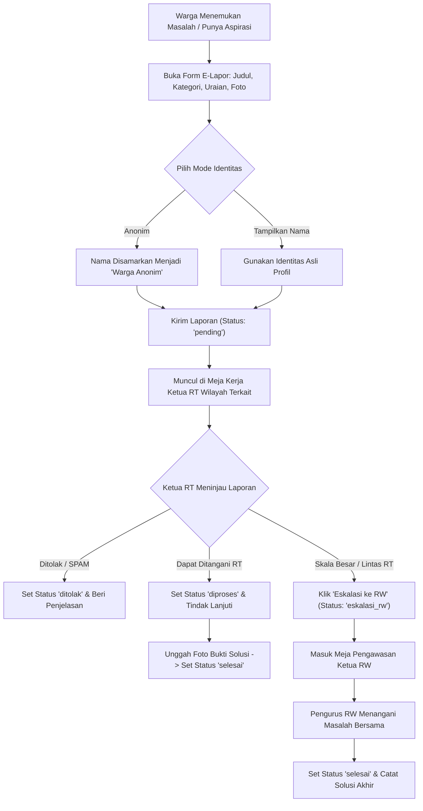
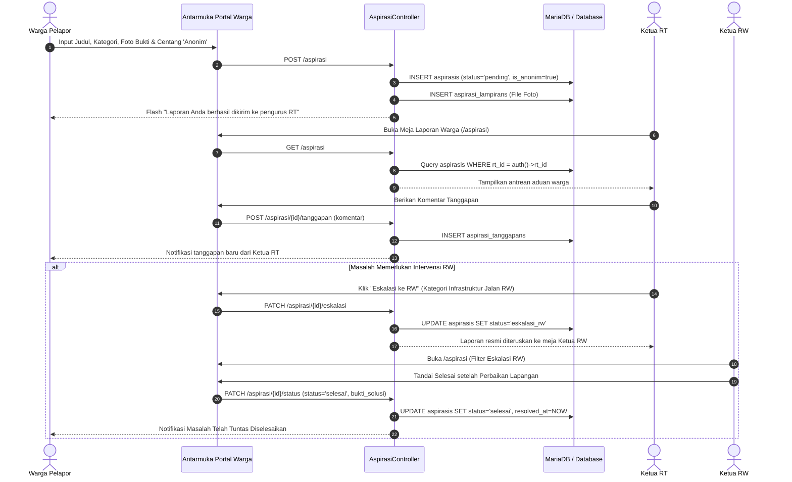
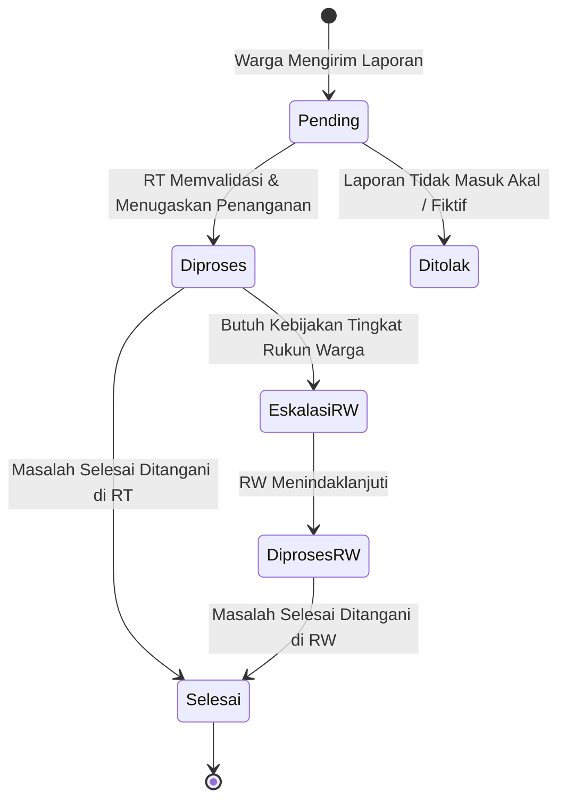

# FITUR: ASPIRASI, PENGADUAN & E-LAPOR WARGA
**File Dokumentasi:** `docs/aspirasi-pengaduan.md`  
**Modul Sistem:** Partisipasi Publik, Kanal Pengaduan Masalah Lingkungan & Eskalasi Bertingkat  
**Hak Akses:** Warga (Pelapor), Ketua RT (Penanggap Tahap 1), Ketua RW (Penanggap Eskalasi)  

---

## 1. Deskripsi & Nilai Bisnis Fitur

Fitur **Aspirasi, Pengaduan & E-Lapor Warga** menyediakan saluran formal, transparan, dan terukur bagi warga untuk menyampaikan saran, keluhan fasilitas umum (jalan berlubang, lampu penerangan jalan mati, saluran mampet, tumpukan sampah liar), maupun gesekan sosial. Fitur ini dilengkapi opsi pelaporan anonim (*whistleblower protection*), diskusi dua arah, dan mekanisme eskalasi penanganan dari tingkat RT ke tingkat RW.

### Masalah yang Diselesaikan:
- Keluhan warga yang tercecer atau tenggelam di grup WhatsApp informal.
- Rasa enggan warga melapor karena takut diintimidasi (diatasi dengan mode pelaporan anonim).
- Ketiadaan *Service Level Agreement* (SLA) dan histori pemantauan progres tindak lanjut masalah lingkungan.
- Hambatan birokrasi ketika masalah RT membutuhkan intervensi dana atau kewenangan RW.

---

## 2. Alur Proses Bisnis & Eskalasi (Escalation Flow)

---

## 3. Diagram UML

### A. Sequence Diagram: Pelaporan Masalah, Tanggapan & Eskalasi ke RW

### B. State Diagram: Siklus Penanganan Aspirasi Lingkungan

---

## 4. Skema Database & Model Terkait

### Tabel Utama:
1. **`aspirasis`**: Data pokok pengaduan (`id`, `user_id`, `rt_id`, `rw_id`, `kategori`, `judul`, `deskripsi`, `anonim`, `status`, `assigned_to`, `resolved_at`, `created_at`).
2. **`aspirasi_lampirans`**: File foto barang bukti kejadian (`id`, `aspirasi_id`, `file_path`, `tipe`).
3. **`aspirasi_tanggapans`**: Jejak percakapan dan klarifikasi (`id`, `aspirasi_id`, `user_id`, `isi_tanggapan`, `is_internal`).

### Model Terkait:
- `App\Models\Aspirasi`: Relasi `belongsTo(User::class)`, `belongsTo(Rt::class)`, `hasMany(AspirasiLampiran::class)`, `hasMany(AspirasiTanggapan::class)`.

---

## 5. Rute & Controller Endpoints

| Method | Endpoint URI | Controller & Action | Deskripsi Hak Akses |
|:---|:---|:---|:---|
| `GET` | `/aspirasi` | `AspirasiController@index` | Dasbor aspirasi (warga & antrean pengurus) |
| `POST` | `/aspirasi` | `AspirasiController@store` | Pengiriman aspirasi/aduan baru oleh warga |
| `GET` | `/aspirasi/{id}` | `AspirasiController@show` | Detail masalah, timeline status & lampiran foto |
| `POST` | `/aspirasi/{id}/tanggapan`| `AspirasiController@tanggapan` | Tambah pesan komentar/tanggapan solusi |
| `PATCH` | `/aspirasi/{id}/status` | `AspirasiController@status` | Update status (Pending, Diproses, Selesai, Tolak)|
| `PATCH` | `/aspirasi/{id}/eskalasi`| `AspirasiController@eskalasi` | Pengurus RT meneruskan laporan ke tingkat RW |
| `GET` | `/aspirasi/rekap` | `AspirasiController@rekap` | Rekapitulasi analitik pengaduan warga bulanan |

---

## 6. Pertimbangan DevOps, Anonimitas & Sanitasi Berkas

1. **Jaminan Kerahasiaan Whistleblower**:
   - Jika kolom `anonim = true`, controller menyamarkan identitas pelapor sebelum data dirender ke antarmuka publik (`$aspirasi->user->name = 'Warga Lingkungan (Anonim)'`), sehingga nama pelapor terlindungi secara mutlak.
2. **Validasi File Bukti Kejadian**:
   - Berkas lampiran foto difilter hanya menerima MIME `image/jpeg`, `image/png`, atau `image/webp` dengan ukuran maksimum 3 MB untuk mencegah injeksi skrip berbahaya (*malicious script upload*).
