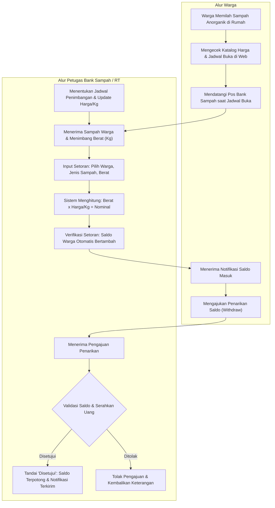
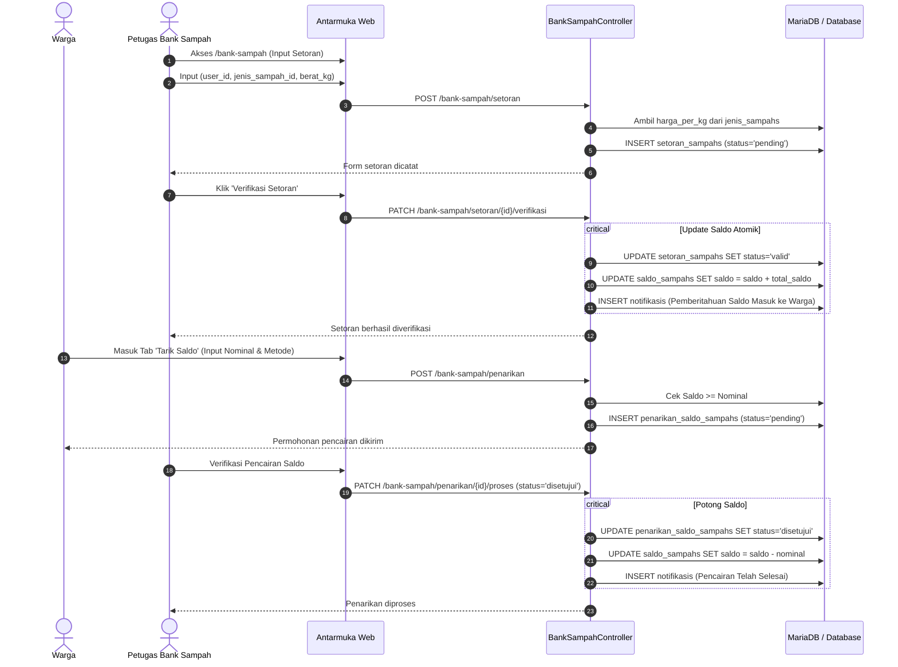
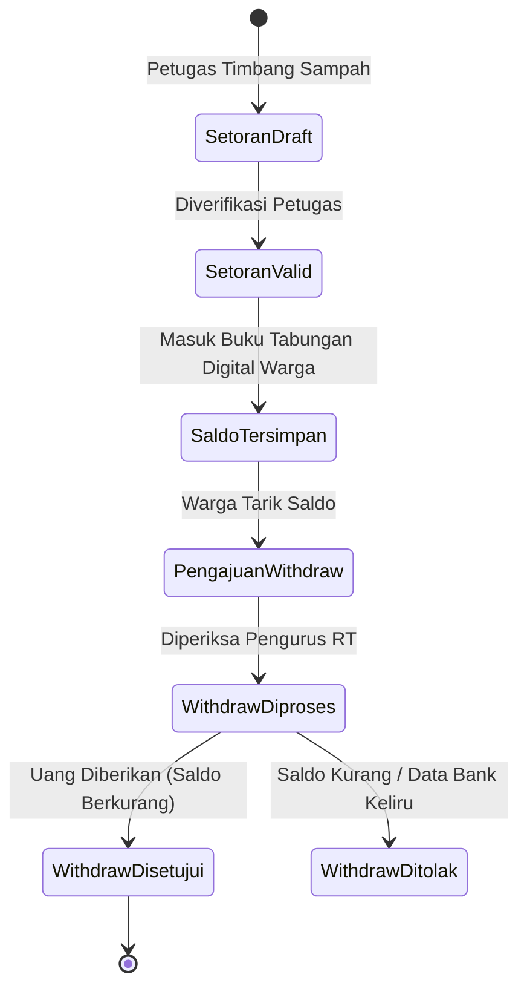

# FITUR: BANK SAMPAH DIGITAL
**File Dokumentasi:** `docs/bank-sampah.md`  
**Modul Sistem:** Bank Sampah, Ekonomi Sirkular & Tabungan Lingkungan  
**Hak Akses:** Ketua RT / Petugas Bank Sampah, Warga  

---

## 1. Deskripsi & Nilai Bisnis Fitur

Fitur **Bank Sampah Digital** mentransformasi tata kelola kebersihan lingkungan menjadi sistem insentif ekonomi sirkular. Warga mengumpulkan sampah anorganik terpilah, membawanya ke titik kumpul pada jadwal operasional bank sampah, ditimbang oleh petugas, dan nilai konversinya dicatatkan secara digital ke dalam saldo tabungan rupiah warga yang dapat dicairkan (*withdraw*).

### Masalah yang Diselesaikan:
- Mengurangi volume sampah yang dibuang ke TPA dengan memberikan nilai ekonomis bagi warga.
- Menghilangkan pencatatan manual berbasis buku fisik yang rentan hilang atau keliru hitung.
- Memberikan transparansi harga per kilogram secara *real-time* kepada seluruh warga.
- Kemudahan pencairan saldo secara tunai maupun transfer rekening bank/e-wallet.

---

## 2. Alur Proses Bisnis (Business Flow)



### Rincian Alur Operasional:
1. **Pembaruan Harga & Jadwal**:
   - Pengurus menentukan harga per kilogram untuk masing-masing komoditas (Plastik, Kardus, Kertas HVS, Logam/Besi, Kaleng Aluminium, Botol Kaca).
   - Pengurus mempublikasikan jadwal buka operasional bank sampah.
2. **Pencatatan Setoran Sampah**:
   - Petugas memilih nama warga pemohon, memilih kategori sampah, dan memasukkan bobot berat (kg).
   - Sistem secara otomatis menghitung `total_saldo = berat_kg * harga_per_kg`.
   - Data tersimpan dalam tabel `setoran_sampahs` dan menunggu verifikasi.
3. **Akumulasi Saldo**:
   - Saat diverifikasi, saldo tabungan warga di tabel `saldo_sampahs` bertambah secara atomik (`DB::transaction`).
4. **Pencairan Saldo (Withdrawal)**:
   - Warga yang memiliki saldo cukup mengajukan permohonan tarik dana dengan memilih metode pencairan (Tunai di Pos RT, Transfer Bank, atau E-Wallet).
   - Pengurus memeriksa permohonan. Jika disetujui, dana diserahkan dan saldo dipotong seketika.

---

## 3. Diagram UML

### A. Sequence Diagram: Setoran Sampah & Penarikan Saldo



### B. State Diagram: Siklus Setoran & Pencairan Saldo



---

## 4. Skema Database & Model Terkait

### Tabel Utama:
1. **`jenis_sampahs`**: Katalog komoditas sampah (`id`, `nama`, `satuan`, `harga_per_kg`, `status`).
2. **`setoran_sampahs`**: Riwayat transaksi timbangan sampah (`id`, `user_id`, `jenis_sampah_id`, `berat_kg`, `harga_per_kg`, `total_saldo`, `status`, `validated_by`, `validated_at`).
3. **`saldo_sampahs`**: Dompet tabungan sampah warga (`id`, `user_id`, `saldo`).
4. **`penarikan_saldo_sampahs`**: Rekam pencairan saldo (`id`, `user_id`, `nominal`, `metode`, `rekening_tujuan`, `status`, `processed_by`, `catatan`).
5. **`jadwal_bank_sampahs`**: Agenda operasional timbang sampah (`id`, `rt_id`, `tanggal`, `waktu_mulai`, `waktu_selesai`, `lokasi`, `keterangan`, `status`).

---

## 5. Rute & Controller Endpoints

| Method | Endpoint URI | Controller & Action | Deskripsi Hak Akses |
|:---|:---|:---|:---|
| `GET` | `/bank-sampah` | `BankSampahController@index` | Tampilan dasbor tabungan (Warga) & operasional (RT) |
| `POST` | `/bank-sampah/setoran` | `BankSampahController@storeSetoran` | Petugas mencatat setoran sampah baru |
| `PATCH` | `/bank-sampah/setoran/{id}/verifikasi`| `BankSampahController@verifySetoran` | Pengesahan timbangan dan penambahan saldo |
| `POST` | `/bank-sampah/harga` | `BankSampahController@updateHarga` | Pengaturan harga per kg komoditas |
| `POST` | `/bank-sampah/jadwal` | `BankSampahController@storeJadwal` | Penjadwalan operasional timbang pos RT |
| `POST` | `/bank-sampah/penarikan` | `BankSampahController@requestWithdrawal` | Warga mengajukan penarikan saldo tabungan |
| `PATCH` | `/bank-sampah/penarikan/{id}/proses` | `BankSampahController@processWithdrawal` | Eksekusi persetujuan atau penolakan penarikan saldo |

---

## 6. Pertimbangan DevOps & Integritas Transaksi

1. **Pencegahan Kondisi Balapan (Race Condition Prevention)**:
   - Operasi penarikan saldo menggunakan query locking:
     ```php
     $dompet = SaldoSampah::where('user_id', $userId)->lockForUpdate()->first();
     if ($dompet->saldo < $request->nominal) {
         throw new Exception("Saldo tidak mencukupi.");
     }
     $dompet->decrement('saldo', $request->nominal);
     ```
   - Hal ini menjamin saldo tidak dapat ditarik ganda secara simultan melalui double-click submission.
2. **Audit Trail Keuangan**:
   - Seluruh mutasi penambahan dan pengurangan saldo dicatat dengan referensi ID petugas pemeriksa (`validated_by` / `processed_by`) untuk mencegah penyalahgunaan dana kas bank sampah.
