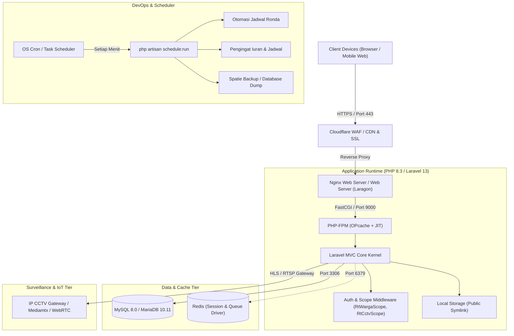
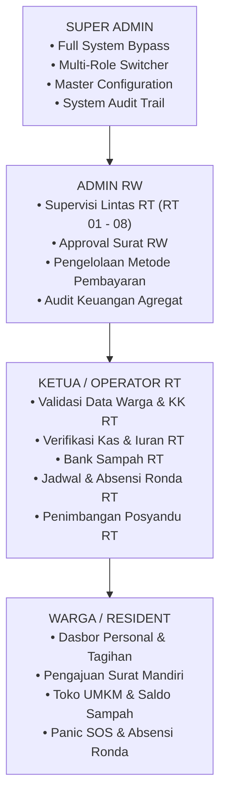
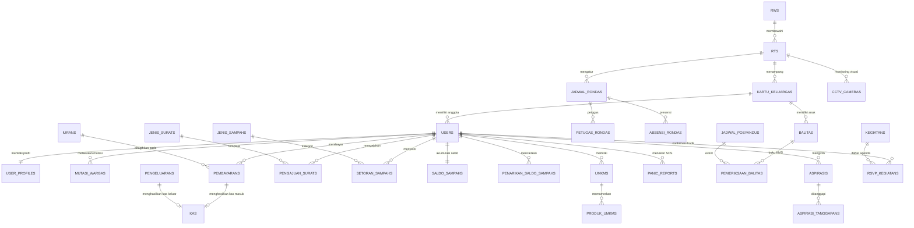
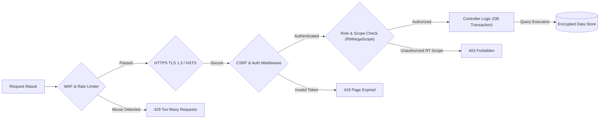

# BLUEPRINT SISTEM I-RT (RISMA-RT)
## Master Enterprise Architecture & DevOps Specifications
**Versi:** 2.4.0-Enterprise  
**Penyusun:** Senior DevOps & Lead Software Engineer  
**Status:** Production Ready  

---

## 1. Executive Summary & Ringkasan Proyek

**I-RT (RISMA-RT / RW-SMART)** adalah platform sistem informasi tata kelola rukun tetangga dan rukun warga modern berbasis web yang dibangun dengan standar arsitektur terisolasi (*multi-tier regional scoping*). Platform ini mengintegrasikan seluruh aspek operasional kemasyarakatan dalam satu dasbor terpadu:

1. **Tata Kelola Kependudukan**: Pendataan warga, KK, dan mutasi domisili.
2. **Keuangan & Kas Terbuka**: Transparansi iuran, kas masuk/keluar, pembayaran digital/QRIS, dan audit real-time.
3. **Ekonomi Sirkular & Lokal**: Bank sampah berbasis tabungan rupiah dan etalase digital UMKM warga.
4. **Birokrasi Cepat (E-Government)**: Pengajuan surat pengantar mandiri berjenjang RT ke RW dengan generator PDF otomatis.
5. **Kesehatan Preventif**: Posyandu balita terintegrasi dengan grafik KMS dan riwayat imunisasi.
6. **Keamanan Cerdas**: Otomasi jadwal ronda malam, absensi GPS, tombol panik SOS, dan integrasi streaming CCTV lingkungan.
7. **Partisipasi Publik**: Forum aspirasi, pengaduan bertingkat, dan manajemen agenda/kegiatan warga.

---

## 2. Arsitektur Infrastruktur & Topologi DevOps

Sistem dirancang untuk efisiensi tinggi, mampu beroperasi pada server bare-metal, VPS resource hemat (1–2 CPU core, 2 GB RAM), maupun cluster cloud modern.



### Spesifikasi Runtime Server
- **Web Server**: Nginx 1.24+ / Apache 2.4 (Laragon Development Stack).
- **PHP Interpreter**: PHP 8.3+ 64-bit dengan ekstensi: `pdo_mysql`, `gd`, `bcmath`, `fileinfo`, `mbstring`, `openssl`, `curl`, `zip`.
- **Database Engine**: MySQL 8.0+ atau MariaDB 10.11+ dengan format penyimpanan `InnoDB` dan charset `utf8mb4_unicode_ci`.
- **Media Engine**: FFMPEG / WebRTC Streamer untuk proxy streaming CCTV lokal RTSP ke HLS HTML5.
- **Queue & Cache**: Driver `database` untuk deployment ringan atau `redis` untuk beban concurrency tinggi.

---

## 3. Matriks Hirarki Multi-Tier & Isolasi Wilayah

Sistem mengadopsi prinsip *Regional Scoped Multi-Tenancy* di mana seluruh entitas diikat oleh `rt_id` dan `rw_id`:



---

## 4. Entity Relationship Global (Core Schema Landscape)

Hubungan antar modul utama dalam basis data digambarkan dalam relasi skema berikut:



---

## 5. Indeks Modul & Direktori Spesifikasi Fitur

Setiap fitur dalam sistem didokumentasikan secara mandiri dan mendalam pada folder `docs/` dengan menyertakan spesifikasi teknis, flow bisnis, diagram UML (Flowchart, Sequence, State), serta pertimbangan DevOps:

| No | Modul & Nama Fitur | Dokumen Spesifikasi Teknis | Model & Entitas Utama | Cakupan Peran |
|:---|:---|:---|:---|:---|
| **1** | **Kependudukan & Wilayah** | [`kependudukan-wilayah.md`](kependudukan-wilayah.md) | `Rw`, `Rt`, `KartuKeluarga`, `Warga`, `UserProfile`, `MutasiWarga` | Super Admin, RW, RT, Warga |
| **2** | **Bank Sampah Digital** | [`bank-sampah.md`](bank-sampah.md) | `JenisSampah`, `SetoranSampah`, `SaldoSampah`, `PenarikanSaldoSampah`, `JadwalBankSampah` | RT, Warga |
| **3** | **UMKM Warga & Marketplace** | [`umkm-warga.md`](umkm-warga.md) | `Umkm`, `ProdukUmkm` | Warga, Pengurus RT/RW |
| **4** | **Pelayanan Surat-Menyurat** | [`surat-menyurat.md`](surat-menyurat.md) | `JenisSurat`, `PengajuanSurat` | Warga, RT, RW |
| **5** | **Posyandu & Balita** | [`posyandu-balita.md`](posyandu-balita.md) | `Balita`, `JadwalPosyandu`, `PemeriksaanBalita` | Kader/RT, Warga |
| **6** | **Keamanan, Ronda & CCTV** | [`keamanan-ronda-cctv.md`](keamanan-ronda-cctv.md) | `JadwalRonda`, `PetugasRonda`, `AbsensiRonda`, `TukarJadwalRonda`, `PanicReport`, `CctvCamera` | RT, RW, Warga |
| **7** | **Kegiatan & RSVP Warga** | [`kegiatan-rsvp.md`](kegiatan-rsvp.md) | `Kegiatan`, `KegiatanPeserta`, `RsvpKegiatan` | RT, RW, Warga |
| **8** | **Aspirasi & Pengaduan** | [`aspirasi-pengaduan.md`](aspirasi-pengaduan.md) | `Aspirasi`, `AspirasiLampiran`, `AspirasiTanggapan` | Warga, RT, RW |
| **9** | **Kas, Iuran & Keuangan** | [`kas-keuangan-digital.md`](kas-keuangan-digital.md) | `Iuran`, `Pembayaran`, `MetodePembayaran`, `Kas`, `Pengeluaran`, `AuditLog` | Warga, Bendahara/RT, RW |
| **10**| **Monitoring, Laporan & Super Admin** | [`monitoring-laporan-superadmin.md`](monitoring-laporan-superadmin.md) | `Laporan`, `AuditLog`, `RtAudit`, `User` (Super Admin switching) | Super Admin, RW, RT |

---

## 6. Arsitektur Keamanan & Mitigasi Risiko DevOps



### Standar Keamanan Sistem
1. **Perlindungan Terhadap IDOR (Insecure Direct Object Reference)**:
   - Akses data permohonan surat, kartu keluarga, dan pembayaran selalu divalidasi silang terhadap kepemilikan (`auth()->id() == $resource->user_id` atau `auth()->user()->rt_id == $resource->rt_id`).
2. **Sanitasi Unggah Berkas**:
   - Berkas lampiran surat, bukti bayar kas, dan foto produk dibatasi tipe MIME (`jpg`, `jpeg`, `png`, `pdf`) dengan ukuran maksimal 2048 KB. Nama file disanitasi menggunakan random UUID hash.
3. **Penyembunyian Data Pribadi (Data Masking)**:
   - Pada direktori publik warga, nomor NIK dan nomor kontak disamarkan (contoh: `3201************0001`) untuk mematuhi regulasi perlindungan data pribadi (UU PDP).

---

## 7. Prosedur Operasional Standar (DevOps Runbook)

### Jadwal Otomasi Crontab (`crontab -e`)
Tambahkan scheduler Laravel untuk berjalan setiap menit pada user web server:
```bash
* * * * * cd /laragon/www/risma-rt && php artisan schedule:run >> /dev/null 2>&1
```

### Script Pencadangan Basis Data Otomatis (Nightly Disaster Recovery)
```bash
#!/bin/bash
BACKUP_DIR="/var/backups/risma-rt"
DATE=$(date +"%Y%m%d_%H%M%S")
mkdir -p $BACKUP_DIR

# Backup SQL
mysqldump -u root -p'password' rw_smart | gzip > "$BACKUP_DIR/db_risma_rt_$DATE.sql.gz"

# Backup Storage Attachments
tar -czf "$BACKUP_DIR/storage_$DATE.tar.gz" -C /laragon/www/risma-rt/storage/app/public .

# Hapus backup lebih tua dari 14 hari
find $BACKUP_DIR -type f -mtime +14 -exec rm {} \;
```

---
*Dokumen ini merupakan referensi resmi arsitektur sistem I-RT (RISMA-RT). Seluruh pengembang dan agen sistem wajib mematuhi ketentuan arsitektur ini.*
