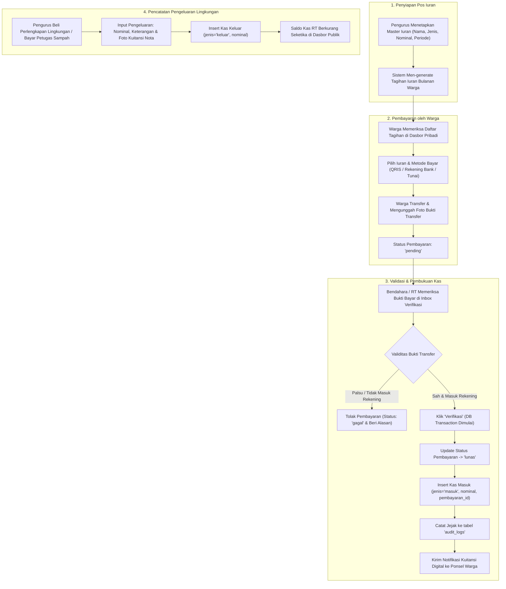
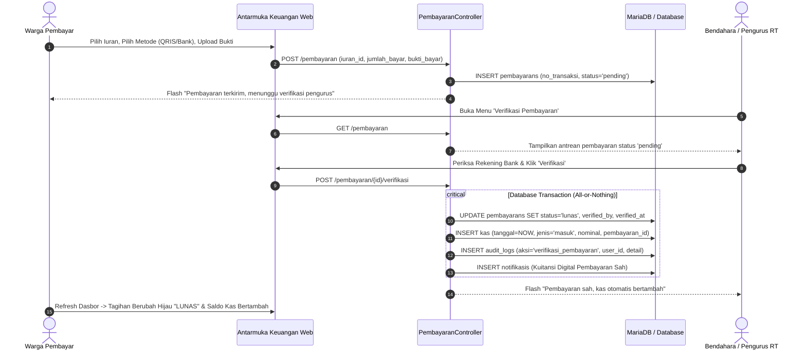
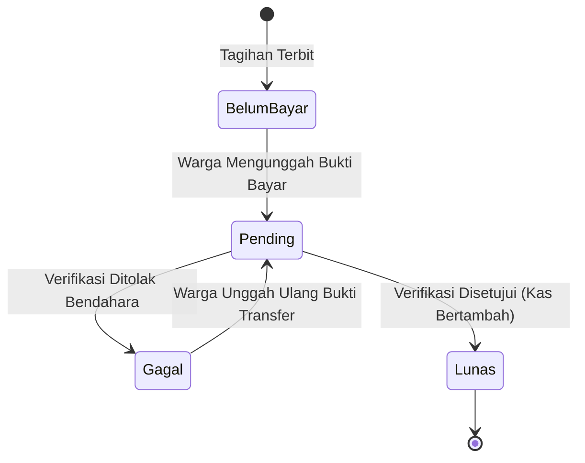

# FITUR: KAS, IURAN & KEUANGAN DIGITAL LINGKUNGAN
**File Dokumentasi:** `docs/kas-keuangan-digital.md`  
**Modul Sistem:** Tata Kelola Kas Transparan, Tagihan Iuran Warga & Multi-Channel Payment  
**Hak Akses:** Warga (Pembayar), Bendahara / Ketua RT (Verifikator Kas RT), Ketua RW (Auditor Kas RW)  

---

## 1. Deskripsi & Nilai Bisnis Fitur

Fitur **Kas, Iuran & Keuangan Digital Lingkungan** adalah pilar integritas dan akuntabilitas keuangan pada ekosistem I-RT (RISMA-RT). Menggantikan pencatatan buku kas kertas dan kuitansi sobekan konvensional yang rawan hilang atau disalahgunakan, modul ini menghadirkan penagihan otomatis iuran rutin (keamanan, kebersihan, kas RT), penerimaan pembayaran digital (QRIS, Transfer Bank), pencatatan pengeluaran dengan bukti nota fisik, serta pembukuan kas masuk/keluar secara *real-time* dan dapat diaudit secara terbuka oleh warga.

### Masalah yang Diselesaikan:
- Kecurigaan antar-warga mengenai transparansi penggunaan dana kas lingkungan.
- Tunggakan iuran yang sulit ditagih karena ketiadaan rekapitulasi digital yang rapi.
- Kerumitan bendahara dalam menyusun laporan pertanggungjawaban bulanan dan tahunan.
- Human error saat menghitung saldo kas akhir dan pencatatan pengeluaran tanpa bukti nota.

---

## 2. Alur Proses Bisnis & Transaksi Keuangan (Financial Flow)

---

## 3. Diagram UML

### A. Sequence Diagram: Pembayaran Iuran & Atomik Pembukuan Kas Masuk

### B. State Diagram: Siklus Status Tagihan Iuran

---

## 4. Skema Database & Model Terkait

### Tabel Utama:
1. **`iurans`**: Master tarif iuran warga (`id`, `rt_id`, `kode_iuran`, `nama_iuran`, `jenis_iuran`, `nominal`, `periode`, `status`, `jatuh_tempo_hari`).
2. **`pembayarans`**: Transaksi setoran iuran (`id`, `no_transaksi`, `user_id`, `iuran_id`, `metode_pembayaran_id`, `tanggal_bayar`, `jumlah_bayar`, `status`, `bukti_bayar`, `verified_by`, `verified_at`).
3. **`metode_pembayarans`**: Channel pembayaran digital (`id`, `rw_id`, `nama_bank`, `nomor_rekening`, `atas_nama`, `kode_channel`, `is_active`, `logo`).
4. **`kas`**: Buku besar buku kas masuk dan keluar (`id`, `rt_id`, `tanggal`, `jenis`, `nominal`, `sumber`, `keterangan`, `pembayaran_id`, `pengeluaran_id`).
5. **`pengeluarans`**: Detail pembelanjaan lingkungan (`id`, `rt_id`, `judul`, `nominal`, `tanggal`, `keterangan`, `bukti_nota`, `created_by`).
6. **`audit_logs`**: Rekam jejak audit finansial (`id`, `user_id`, `action`, `module`, `ip_address`, `detail_json`, `created_at`).

---

## 5. Rute & Controller Endpoints

| Method | Endpoint URI | Controller & Action | Deskripsi Hak Akses |
|:---|:---|:---|:---|
| `RESOURCE` | `/iuran` | `IuranController` | Kelola master tarif iuran RT |
| `PATCH` | `/iuran/{id}/toggle-status` | `IuranController@toggleStatus` | Aktifkan/nonaktifkan pos iuran |
| `RESOURCE` | `/pembayaran` | `PembayaranController` | Transaksi pembayaran & unggah bukti transfer |
| `POST` | `/pembayaran/{id}/verifikasi`| `PembayaranController@verifikasi` | Validasi bukti bayar & pencatatan kas otomatis |
| `GET` | `/kas` | `KasController@index` | Dasbor buku kas terbuka & grafik arus kas |
| `RESOURCE` | `/pengeluaran` | `PengeluaranController` | Entri pengeluaran kas lingkungan & nota fisik |
| `RESOURCE` | `/rw/metode-pembayaran` | `MetodePembayaranController` | Master rekening bank & QRIS pengurus |
| `GET` | `/audit-keuangan` | `AuditKeuanganController@index` | Supervisi audit keuangan lintas RT oleh RW |

---

## 6. Pertimbangan DevOps & Integritas Finansial

1. **Jaminan ACID Transaksi (Atomicity, Consistency, Isolation, Durability)**:
   - Pencatatan kas masuk dari pembayaran iuran **wajib** menggunakan `DB::transaction()`. Jika pembuatan baris kas gagal, status pembayaran tidak boleh berubah menjadi `lunas`. Hal ini menjamin mutasi bank fisik selalu cocok (*recon*) dengan saldo buku kas digital.
2. **Pencegahan Nomor Transaksi Ganda (Unique Transaction Sequence)**:
   - Nomor transaksi dibuat dengan formula acak berurut: `TRX-{TAHUN}{BULAN}{HARI}-{RANDOM_HEX}` (contoh: `TRX-20261113-7F2A`) dengan constraint *unique key* di level database.
3. **Penyimpanan Nota Bukti Pengeluaran**:
   - Nota pengeluaran wajib diunggah dalam format gambar/PDF dan diarsipkan di direktori penyimpanan terisolasi untuk memudahkan inspeksi sewaktu audit rapat tahunan warga.
