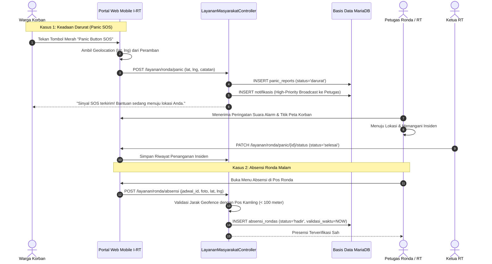
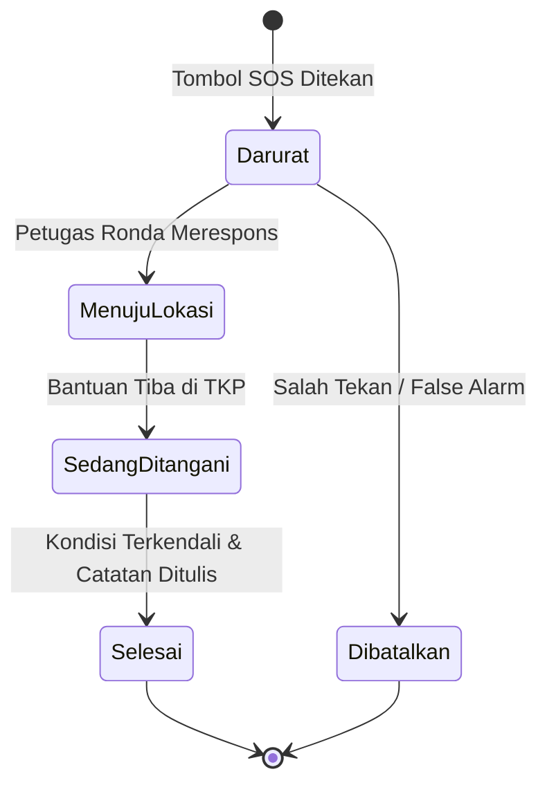

# FITUR: SISTEM KEAMANAN LINGKUNGAN, RONDA & CCTV SURVEILLANCE
**File Dokumentasi:** `docs/keamanan-ronda-cctv.md`  
**Modul Sistem:** Ketertiban Lingkungan, Ronda Malam Otomatis, Panic Button SOS & CCTV Streaming  
**Hak Akses:** Ketua RT, Koordinator Keamanan, Warga Lingkungan, Pengawas RW  

---

## 1. Deskripsi & Nilai Bisnis Fitur

Fitur **Sistem Keamanan Lingkungan, Ronda & CCTV Surveillance** menghadirkan proteksi terpadu bagi warga. Menggabungkan otomasi penjadwalan giliran ronda malam yang adil, mekanisme pertukaran shift antar-warga, validasi kehadiran berbasis geolokasi GPS & swafoto, tombol darurat (*Panic Button SOS*) berlatensi rendah, serta integrasi pemantauan kamera pengawas CCTV lingkungan secara *live streaming*.

### Masalah yang Diselesaikan:
- Konflik jadwal ronda manual yang dinilai tidak merata atau pilih kasih.
- Ketidakhadiran ronda tanpa kabar yang menyebabkan pos kamling kosong.
- Keterlambatan respon saat terjadi insiden genting (kebakaran, pencurian, darurat medis) di malam hari.
- Keterbatasan warga dalam memantau sudut-sudut rawan dan akses gerbang lingkungan secara visual.

---

## 2. Alur Proses Bisnis Terpadu (Security Ecosystem Flow)

```mermaid
flowchart TD
    subgraph RondaSubsystem["1. Penjadwalan & Presensi Ronda"]
        A1["Ketua RT Buka Generator Ronda Otomatis"] --> A2["Sistem Mengacak Warga Aktif Sesuai Kuota Shift"]
        A2 --> A3["Preview & Simpan Batch Jadwal Bulanan"]
        A3 --> A4["Broadcast Jadwal & Kirim Pengingat H-1"]
        A4 --> A5{"Warga Bisa Hadir?"}
        A5 -->|Tidak Bisa| A6["Ajukan Tukar Shift ke Tetangga Lain"]
        A6 --> A7["Tetangga Menerima -> Jadwal Ditukar Otomatis"]
        A5 -->|Hadir| A8["Presensi di Pos: Validasi GPS Geolokasi + Foto"]
    end

    subgraph EmergencySubsystem["2. Tanggap Darurat (Panic Button SOS)"]
        E1["Warga Menghadapi Bahaya / Medis / Kebakaran"] --> E2["Tekan Tombol Merah 'Panic Button SOS'"]
        E2 --> E3["GPS Browser Mengunci Latitude & Longitude Korban"]
        E3 --> E4["Sirene Web & Notifikasi Darurat Berdering di Ponsel Petugas Ronda & RT"]
        E4 --> E5["Petugas Bergerak ke Titik Koordinat & Tangani Bahaya"]
        E5 --> E6["Pengurus Menandai 'Status: Ditangani / Selesai'"]
    end

    subgraph CCTVSubsystem["3. Smart CCTV Monitoring"]
        C1["Kamera IP Terpasang di Gerbang & Titik Rawan"] --> C2["RTSP Gateway Konversi ke HLS HTML5 Player"]
        C2 --> C3["Warga & Pengurus Memantau Live Stream 24/7"]
        C3 --> C4["Pemutaran Arsip Rekaman Kejadian Penting"]
    end
```

---

## 3. Diagram UML

### A. Sequence Diagram: Tanggap Darurat Panic Button & Presensi Ronda GPS

### B. State Diagram: Siklus Insiden Panic Report

---

## 4. Skema Database & Model Terkait

### Tabel Utama:
1. **`jadwal_rondas`**: Master tanggal dan shift ronda (`id`, `rt_id`, `tanggal`, `shift`, `lokasi_pos`, `status`).
2. **`petugas_rondas`**: Penugasan warga pada shift (`id`, `jadwal_ronda_id`, `user_id`, `peran`).
3. **`tukar_jadwal_rondas`**: Transaksi pertukaran jadwal antar-warga (`id`, `jadwal_asal_id`, `jadwal_tujuan_id`, `user_pemohon_id`, `user_pengganti_id`, `status`, `catatan`).
4. **`absensi_rondas`**: Log presensi kehadiran (`id`, `jadwal_ronda_id`, `user_id`, `status`, `waktu_absen`, `foto_bukti`, `lokasi_lat`, `lokasi_lng`).
5. **`panic_reports`**: Catatan panggilan darurat (`id`, `user_id`, `rt_id`, `judul`, `deskripsi`, `lokasi_lat`, `lokasi_lng`, `status`, `handled_by`, `resolved_at`).
6. **`cctv_cameras`**: Konfigurasi kamera CCTV (`id`, `rt_id`, `nama_kamera`, `lokasi`, `stream_url`, `snapshot_url`, `status_aktif`, `is_public`).
7. **`cctv_recordings`**: Arsip tautan rekaman CCTV (`id`, `cctv_camera_id`, `judul`, `waktu_mulai`, `waktu_selesai`, `file_path`).

---

## 5. Rute & Controller Endpoints

| Method | Endpoint URI | Controller & Action | Deskripsi Hak Akses |
|:---|:---|:---|:---|
| `GET` | `/layanan/ronda` | `LayananMasyarakatController@ronda` | Kalender jadwal, presensi & kontak darurat |
| `POST` | `/layanan/ronda/generate-preview` | `LayananMasyarakatController@generatePreviewRonda` | Algoritma pengacakan jadwal warga |
| `POST` | `/layanan/ronda/simpan-otomatis` | `LayananMasyarakatController@simpanJadwalOtomatis` | Simpan permanen jadwal hasil generate |
| `POST` | `/layanan/ronda/jadwal/{id}/ingatkan`| `LayananMasyarakatController@kirimPengingatRonda` | Kirim notifikasi pengingat bertugas ke ponsel |
| `POST` | `/layanan/ronda/tukar` | `LayananMasyarakatController@requestTukarRonda` | Form pengajuan tukar giliran ronda |
| `PATCH` | `/layanan/ronda/tukar/{id}/respon` | `LayananMasyarakatController@responTukarRonda` | Terima / tolak permintaan tukar shift |
| `POST` | `/layanan/ronda/absensi` | `LayananMasyarakatController@storeAbsensiRonda` | Unggah presensi swafoto & lokasi GPS pos |
| `POST` | `/layanan/ronda/panic` | `LayananMasyarakatController@storePanicReport` | Pemicu tombol SOS darurat |
| `PATCH` | `/layanan/ronda/panic/{id}/status` | `LayananMasyarakatController@updatePanicReportStatus`| Tandai penanganan insiden darurat |
| `GET` | `/layanan/ronda/cctv` | `CctvController@live` | Pemutar live video kamera lingkungan |
| `GET` | `/layanan/ronda/cctv/recordings` | `CctvController@recordings` | Daftar rekaman video arsip kamera |
| `RESOURCE` | `/layanan/ronda/cctv/cameras` | `CctvController` | CRUD master data RTSP IP Camera |

---

## 6. Pertimbangan DevOps, Streaming CCTV & GPS Geofencing

1. **Streaming RTSP ke HLS via Gateway Mediamtx / WebRTC**:
   - Kamera IP lingkungan yang menggunakan protokol lokal RTSP dikonversi menggunakan media gateway ringan (seperti MediaMTX atau go2rtc) menjadi protokol HLS/WebRTC agar dapat diputar langsung di elemen `<video>` peramban tanpa memerlukan plugin tambahan.
2. **Validasi Geofence Matematika (Haversine Formula)**:
   - Presensi ronda menghitung jarak Euclidean/Haversine antara koordinat perangkat petugas dengan koordinat GPS Pos Ronda. Jika jarak melebihi 100 meter, sistem menandai presensi mencurigakan (*outside designated area*).
3. **Penyekatan Kamera Antar-RT (`RtCctvScope`)**:
   - Hak akses streaming kamera pengawas diproteksi oleh scope RT, sehingga warga atau pengurus RT 01 tidak dapat mengintip CCTV yang berada di wilayah privat RT 02 kecuali diberi izin akses publik lingkungan.
