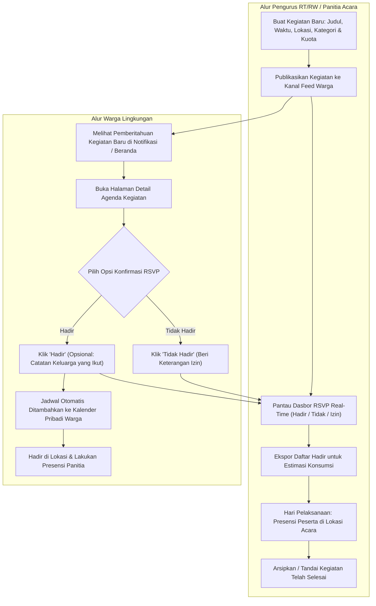
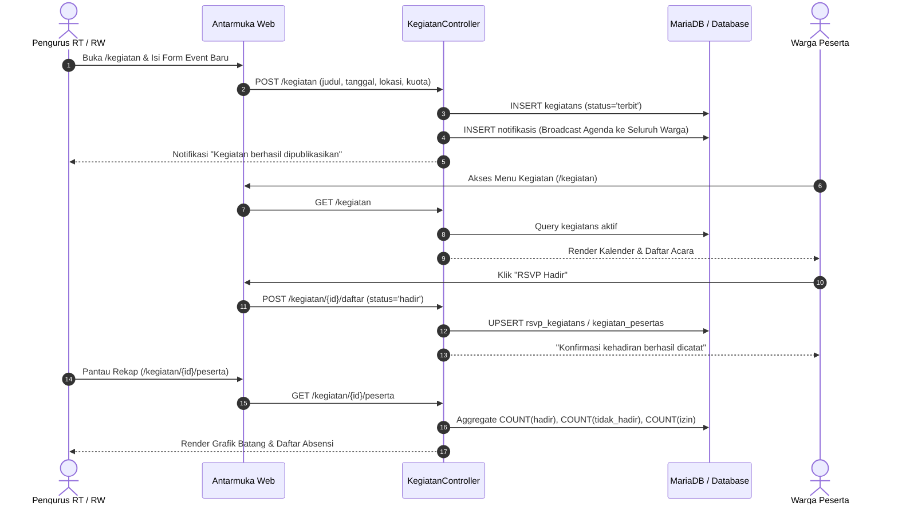
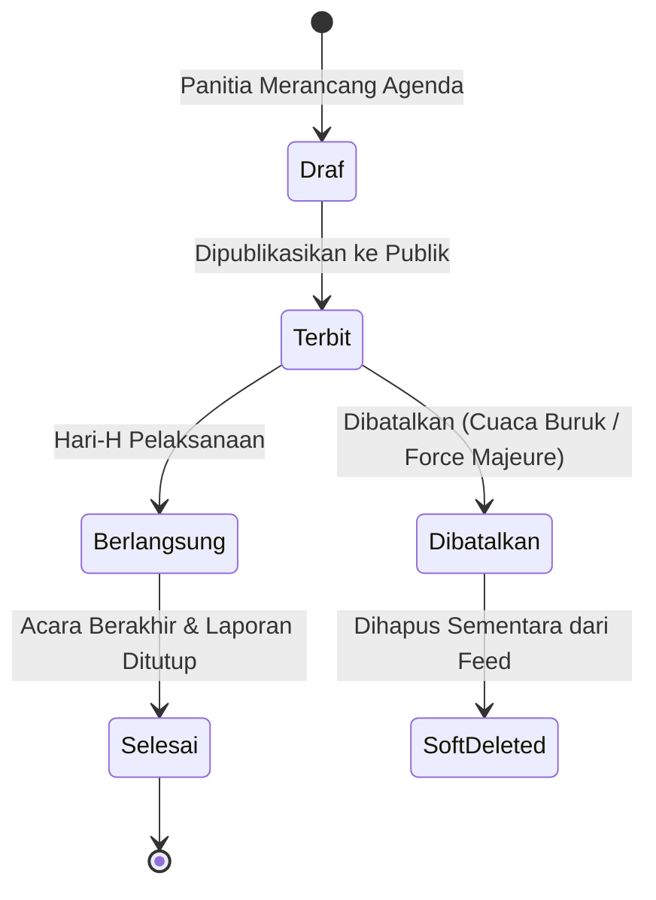

# FITUR: AGENDA KEGIATAN & RSVP WARGA
**File Dokumentasi:** `docs/kegiatan-rsvp.md`  
**Modul Sistem:** Manajemen Event Kemasyarakatan, Registrasi Peserta & Presensi Kegiatan  
**Hak Akses:** Ketua RW, Ketua RT, Panitia Kegiatan, Warga Lingkungan  

---

## 1. Deskripsi & Nilai Bisnis Fitur

Fitur **Agenda Kegiatan & RSVP Warga** mengelola seluruh siklus acara kemasyarakatan di lingkungan RT dan RW (seperti Kerja Bakti, Rapat Warga, Peringatan HUT RI, Pengajian Rutin, Senam Bersama, dan Lomba Lingkungan). Fitur ini mengeliminasi ketidakpastian estimasi jumlah warga yang akan hadir melalui sistem RSVP digital terintegrasi, mempermudah panitia dalam penganggaran konsumsi dan logistik acara.

### Masalah yang Diselesaikan:
- Pemborosan anggaran konsumsi akibat ketidaktahuan jumlah warga yang hadir.
- Rendahnya partisipasi warga karena informasi undangan kertas yang sering tercecer.
- Ketiadaan arsip presensi dan dokumentasi rekap kegiatan lingkungan masa lalu.
- Pengelolaan kepanitiaan acara yang tidak terkoordinasi antar-RT.

---

## 2. Alur Proses Bisnis (Business Flow)

---

## 3. Diagram UML

### A. Sequence Diagram: Pembuatan Agenda & Konfirmasi Kehadiran (RSVP)

### B. State Diagram: Siklus Hidup Agenda Acara

---

## 4. Skema Database & Model Terkait

### Tabel Utama:
1. **`kegiatans`**: Master agenda kegiatan (`id`, `rt_id`, `rw_id`, `judul`, `kategori`, `tanggal_mulai`, `tanggal_selesai`, `lokasi`, `kuota_peserta`, `deskripsi`, `status`, `created_by`, `deleted_at`).
2. **`kegiatan_pesertas` / `rsvp_kegiatans`**: Data partisipasi warga (`id`, `kegiatan_id`, `user_id`, `status_kehadiran`, `catatan`, `waktu_presensi_lokasi`).

### Model Terkait:
- `App\Models\Kegiatan`: Menggunakan trait `SoftDeletes`, relasi `belongsTo(Rt::class)`, `belongsTo(Rw::class)`, dan `hasMany(KegiatanPeserta::class)`.
- `App\Models\KegiatanPeserta`: Relasi `belongsTo(User::class)`.

---

## 5. Rute & Controller Endpoints

| Method | Endpoint URI | Controller & Action | Deskripsi Hak Akses |
|:---|:---|:---|:---|
| `GET` | `/kegiatan` | `KegiatanController@index` | Daftar feed kegiatan terbuka & filter kategori |
| `POST` | `/kegiatan` | `KegiatanController@store` | Pembuatan acara baru oleh pengurus lingkungan |
| `PATCH` | `/kegiatan/{id}` | `KegiatanController@update` | Pembaruan informasi waktu/lokasi acara |
| `DELETE`| `/kegiatan/{id}` | `KegiatanController@destroy` | Hapus permanen kegiatan |
| `DELETE`| `/kegiatan/{id}/soft-delete`| `KegiatanController@softDeleteCancelled`| Batalkan kegiatan & sembunyikan dari feed |
| `POST` | `/kegiatan/{id}/daftar`| `KegiatanController@daftar` | Submit status RSVP hadir oleh warga |
| `DELETE`| `/kegiatan/{id}/daftar`| `KegiatanController@batalDaftar` | Pembatalan kehadiran oleh warga |
| `GET` | `/kegiatan/{id}/peserta`| `KegiatanController@peserta` | Meja panitia: Rekap dan presensi peserta |
| `PATCH` | `/kegiatan/{id}/peserta/{user}`| `KegiatanController@updatePeserta` | Update presensi manual saat registrasi ulang di lokasi |

---

## 6. Pertimbangan DevOps & Optimasi Kinerja

1. **Agregasi Cache Penghitungan RSVP**:
   - Untuk kegiatan berskala besar seluruh RW dengan ribuan peserta, query agregat `COUNT(status)` disimpan dalam cache runtime selama 60 detik (`Cache::remember("kegiatan_{$id}_stat", 60, ...)`).
2. **Audit Pembatalan Acara (Soft Delete Trait)**:
   - Pembatalan acara tidak serta merta menghapus baris dari database agar jejak riwayat logistik dan notifikasi ke warga tetap utuh (`deleted_at IS NOT NULL`).
