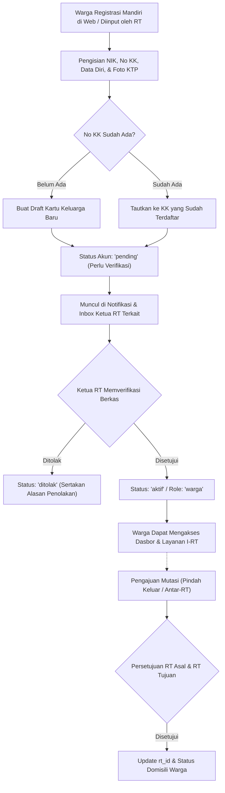
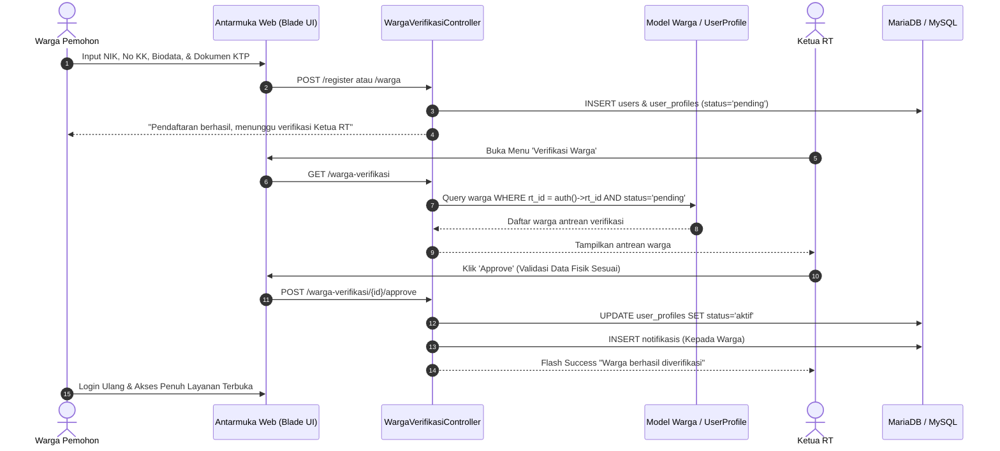
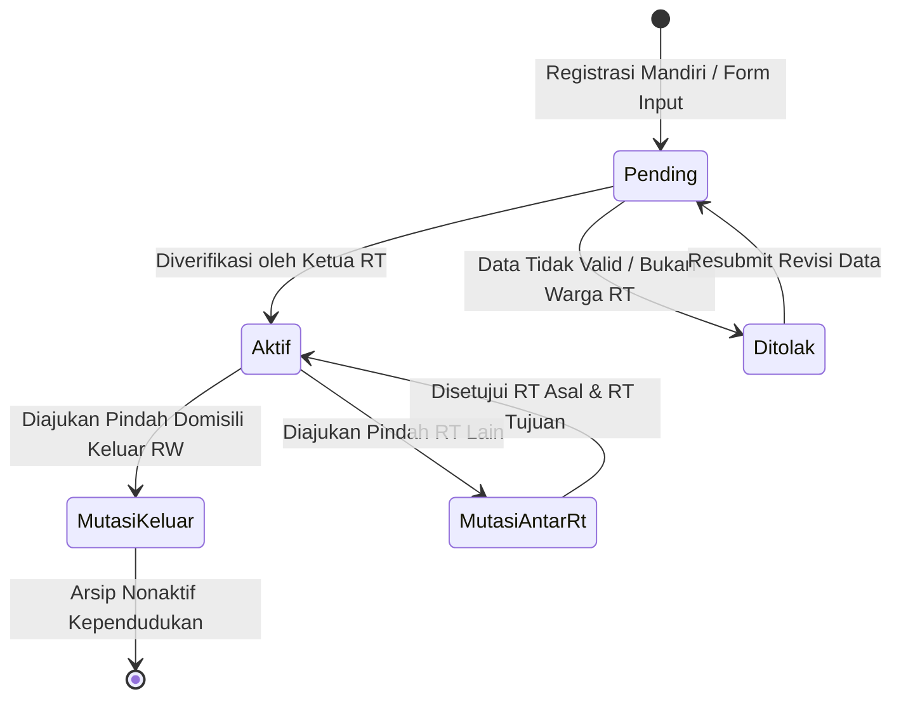

# FITUR: KEPENDUDUKAN & WILAYAH TERPADU
**File Dokumentasi:** `docs/kependudukan-wilayah.md`  
**Modul Sistem:** Kependudukan, Wilayah RT/RW, Kartu Keluarga & Mutasi Warga  
**Hak Akses:** Super Admin, Ketua RW, Ketua RT, Warga  

---

## 1. Deskripsi & Nilai Bisnis Fitur

Fitur **Kependudukan & Wilayah Terpadu** adalah fondasi identitas digital dari sistem I-RT (RISMA-RT). Fitur ini mendigitalkan pencatatan struktur teritorial rukun tetangga dan rukun warga, buku induk kependudukan, Kartu Keluarga (KK), relasi keluarga, serta riwayat perpindahan domisili warga (*mutasi kependudukan*).

### Masalah yang Diselesaikan:
- Penghapusan data ganda (duplikasi NIK dan nomor KK).
- Otomasi pendataan warga pendatang baru tanpa verifikasi manual yang lambat.
- Pelacakan histori kepindahan warga (masuk, keluar, atau pindah antar-RT) dengan transparansi antar-pengurus RT.
- Penerbitan salinan digital KK dan kartu identitas warga tingkat lingkungan.

---

## 2. Alur Proses Bisnis (Business Flow)

### Rincian Alur Pengguna:
1. **Pendaftaran Warga Baru**:
   - Warga mendaftar dengan memilih RT domisili, mengunggah foto KTP/KK, dan mengisi identitas kependudukan.
   - Akun berstatus `pending` dan secara otomatis diisolasi oleh `RtWargaScope` agar hanya muncul di panel verifikasi Ketua RT wilayah tersebut.
2. **Verifikasi Ketua RT**:
   - Ketua RT mengecek kebenaran data fisik dan NIK.
   - Jika valid, status diubah menjadi `aktif` (men-generate profil kependudukan penuh). Jika tidak valid, RT memasukkan catatan penolakan.
3. **Manajemen Kartu Keluarga (KK)**:
   - Pengurus atau Kepala Keluarga dapat mengelola susunan anggota keluarga (Kepala Keluarga, Istri, Anak, Famili Lain).
   - Tersedia tombol cetak salinan lembar KK digital berbasis PDF (`DomPDF`).
4. **Mutasi Kependudukan**:
   - **Mutasi Masuk**: Pencatatan warga pindahan dari luar wilayah RW.
   - **Mutasi Keluar**: Penonaktifan warga yang pindah keluar wilayah RW dengan mencatat alamat baru dan tanggal keluar.
   - **Mutasi Antar-RT**: Perpindahan warga dari satu RT ke RT lain dalam RW yang sama, membutuhkan persetujuan RT asal dan verifikasi RT tujuan.

---

## 3. Diagram UML

### A. Sequence Diagram: Pendaftaran & Verifikasi Warga

### B. State Diagram: Siklus Status Kependudukan Warga

---

## 4. Skema Database & Model Terkait

### Tabel Utama:
1. **`rws`**: Master wilayah Rukun Warga (`id`, `kode_rw`, `nama_rw`, `ketua_user_id`).
2. **`rts`**: Master wilayah Rukun Tetangga (`id`, `rw_id`, `kode_rt`, `nama_rt`, `ketua_user_id`).
3. **`kartu_keluargas`**: Master data nomor KK (`id`, `rt_id`, `no_kk`, `kepala_keluarga_user_id`, `alamat`, `status_rumah`).
4. **`users`**: Entitas akun login (`id`, `name`, `email`, `password`, `role_id`, `rt_id`, `is_super_admin`).
5. **`user_profiles`**: Rincian kependudukan lengkap (`id`, `user_id`, `nik`, `kk_id`, `rt_id`, `rw_id`, `alamat`, `tanggal_lahir`, `jenis_kelamin`, `pekerjaan`, `agama`, `foto`, `status`).
6. **`mutasi_wargas`**: Log dan transaksi mutasi (`id`, `user_id`, `jenis_mutasi`, `rt_asal_id`, `rt_tujuan_id`, `tanggal_mutasi`, `alasan`, `status`, `approved_by`).

---

## 5. Rute & Controller Endpoints

| Method | Endpoint URI | Controller & Action | Deskripsi Hak Akses |
|:---|:---|:---|:---|
| `GET` | `/warga` | `WargaController@index` | Menampilkan master data warga (terisolasi scope RT) |
| `POST` | `/warga` | `WargaController@store` | Input warga baru secara manual oleh RT |
| `GET` | `/warga-verifikasi` | `WargaVerifikasiController@index` | Daftar antrean verifikasi warga berstatus `pending` |
| `POST` | `/warga-verifikasi/{id}/approve` | `WargaVerifikasiController@approve` | Pengesahan aktivasi akun warga oleh Ketua RT |
| `POST` | `/warga-verifikasi/{id}/reject` | `WargaVerifikasiController@reject` | Penolakan pendaftaran dengan catatan |
| `RESOURCE` | `/kartu-keluarga` | `KartuKeluargaController` | CRUD data Kartu Keluarga tingkat lingkungan |
| `GET` | `/kartu-keluarga/{id}/cetak` | `KartuKeluargaController@cetak` | Generate salinan PDF lembar Kartu Keluarga |
| `POST` | `/warga/mutasi/antar-rt` | `WargaController@storeMutasiAntarRt` | Form permohonan kepindahan antar-RT |
| `POST` | `/warga/mutasi/{id}/approve` | `WargaController@approveMutasi` | Konfirmasi perpindahan oleh pengurus RT tujuan |

---

## 6. Pertimbangan DevOps, Keamanan & Skalabilitas

1. **Enforcement Global Scope (`RtWargaScope`)**:
   - Model `Warga` dan `UserProfile` mengimplementasikan `RtWargaScope`. Jika pengguna yang sedang login bukan Super Admin/RW, query secara otomatis ditambahkan klausa `WHERE rt_id = ?`. Hal ini mencegah celah kebocoran data antar-RT.
2. **Penyimpanan Berkas KTP/KK Terenkripsi & Sanitasi**:
   - Berkas KTP hanya dapat diakses melalui URL bertanda tangan (*temporary signed route*) atau streaming controller berproteksi autentikasi, tidak boleh terekspos secara direct static URL tanpa izin.
3. **Pemberian Indeks Kolom Frekuensi Tinggi**:
   - Kolom `nik`, `no_kk`, `rt_id`, dan `status` diberikan index b-tree untuk menjaga kecepatan pencarian instan pada populasi ribuan warga.
