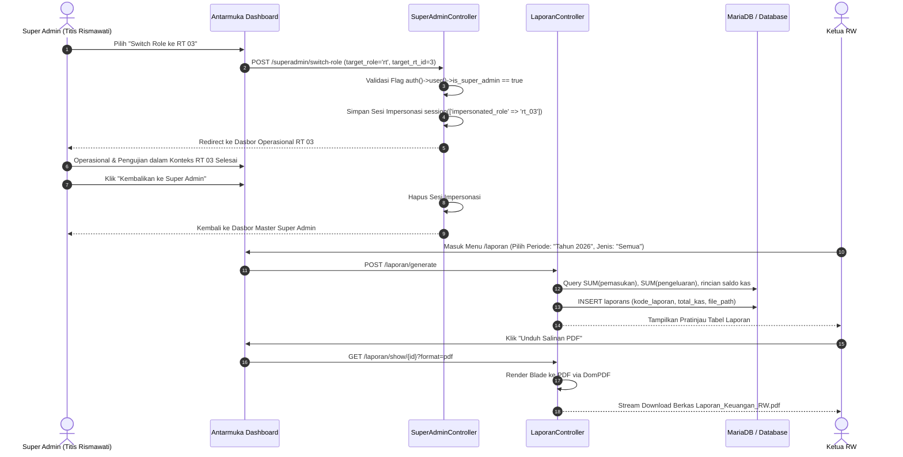
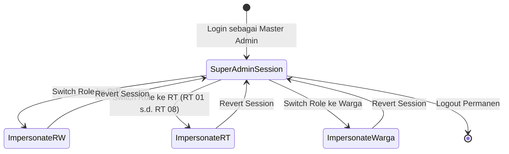

# FITUR: MONITORING WILAYAH, LAPORAN AGREGAT & TATA KELOLA SUPER ADMIN
**File Dokumentasi:** `docs/monitoring-laporan-superadmin.md`  
**Modul Sistem:** Pusat Kendali Eksekutif, Pengawasan Lintas RT, Pelaporan Keuangan & Super Admin Engine  
**Hak Akses:** Super Admin (Titis Rismawati), Ketua RW, Pengurus Wilayah  

---

## 1. Deskripsi & Nilai Bisnis Fitur

Fitur **Monitoring Wilayah, Laporan Agregat & Tata Kelola Super Admin** berfungsi sebagai ruang kendali utama (*war room*) eksekutif bagi pimpinan lingkungan (Ketua RW dan Master Administrator). Modul ini menyediakan visibilitas 360 derajat atas dinamika populasi, kepatuhan pembayaran kas, pengawasan surat-menyurat berjenjang, generator pelaporan keuangan periodik (ekspor PDF & Excel), visualisasi peta wilayah spasial GIS, serta fitur mutakhir **Multi-Role Switching** untuk simulasi dan audit operasional langsung di lapangan tanpa membocorkan kredensial.

### Masalah yang Diselesaikan:
- Kesulitan Ketua RW dalam memantau kinerja dan kepatuhan administrasi 8 RT yang berbeda.
- Lamanya proses penyusunan lembar laporan pertanggungjawaban tahunan ke kelurahan/warga.
- Kebutuhan inspeksi dan pengujian sistem oleh administrator tanpa harus logout-login berulang kali.
- Ketiadaan audit trail komprehensif ketika terjadi perselisihan data keuangan atau perubahan status warga.

---

## 2. Alur Proses Bisnis & Supervisi (Supervisory Flow)

```mermaid
flowchart TD
    subgraph SuperAdminCore["1. Tata Kelola Super Admin"]
        SA1["Super Admin Login ke Portal"] --> SA2["Buka 'War Room Dashboard'"]
        SA2 --> SA3{"Fitur Multi-Role Switching"}
        SA3 -->|Pilih Konteks RW| SA4["Sistem Mengubah Sesi Menjadi 'Ketua RW'"]
        SA3 -->|Pilih Konteks RT| SA5["Sistem Mengubah Sesi Menjadi 'Ketua RT 01 - 08'"]
        SA3 -->|Pilih Konteks Warga| SA6["Sistem Mengubah Sesi Menjadi 'Warga Biasa'"]
        SA4 & SA5 & SA6 --> Inspect["Inspeksi Data Langsung di Lapangan Tanpa Ubah Password"]
    end

    subgraph RWMonitoring["2. Monitoring Wilayah Lintas RT (Ketua RW)"]
        RW1["Akses /monitoring/warga & /monitoring/layanan"] --> RW2["Tinjau Komparasi Kinerja Seluruh RT (RT 01 s.d. 08)"]
        RW2 --> RW3["Pantau Peta Spasial Titik Fasilitas & Kamera CCTV"]
        RW3 --> RW4["Audit Rekapitulasi Kas & Iuran Masuk Setiap RT"]
    end

    subgraph ReportingEngine["3. Generator Laporan Keuangan"]
        R1["Pilih Parameter Periode (Bulan / Tahun / Jenis Iuran)"] --> R2["Klik 'Generate Laporan'"]
        R2 --> R3["Agregasi Data Pembayaran, Pengeluaran & Saldo Kas"]
        R3 --> R4{"Format Ekspor"}
        R4 -->|Cetak Resmi| R5["Generate Berkas PDF (DomPDF Berstempel Digital)"]
        R4 -->|Analisis Angka| R6["Generate Spreadsheet XLSX (Maatwebsite Excel)"]
    end
```

---

## 3. Diagram UML

### A. Sequence Diagram: Multi-Role Switching & Generator Laporan Agregat

### B. State Diagram: Siklus Sesi Multi-Role Switching

---

## 4. Skema Database & Model Terkait

### Tabel Utama:
1. **`laporans`**: Arsip rekapitulasi keuangan periodik (`id`, `rt_id`, `kode_laporan`, `jenis_laporan`, `periode_bulan`, `periode_tahun`, `total_pemasukan`, `total_pengeluaran`, `saldo_akhir`, `status`, `dibuat_oleh`).
2. **`audit_logs`**: Log audit jejak rekam transaksi kritis (`id`, `user_id`, `action`, `module`, `ip_address`, `user_agent`, `payload_sebelum`, `payload_sesudah`, `created_at`).
3. **`rt_audits`**: Catatan status kepatuhan operasional RT (`id`, `rt_id`, `audited_by_rw`, `status_pemeriksaan`, `catatan_inspeksi`, `tanggal_audit`).

### Model Terkait:
- `App\Models\Laporan`: Menyimpan metadata ringkasan keuangan.
- `App\Models\AuditLog`: Audit trail immutable (hanya *insert*, tidak boleh di-*update* atau di-*delete*).
- `App\Models\RtAudit`: Relasi supervisi antar-wilayah.

---

## 5. Rute & Controller Endpoints

| Method | Endpoint URI | Controller & Action | Deskripsi Hak Akses |
|:---|:---|:---|:---|
| `POST` | `/superadmin/switch-role` | `SuperAdminController@switchRole` | Saklar instan pergantian peran sesi |
| `GET` | `/superadmin/dashboard` | `SuperAdminController@dashboard` | War room status server & kesehatan sistem |
| `GET` | `/superadmin/audit-logs` | `SuperAdminController@auditLogs` | Penelusuran jejak rekam log aktivitas global |
| `GET` | `/monitoring/warga` | `MonitoringWilayahController@wargaPerRt` | Visualisasi statistik kependudukan per RT |
| `GET` | `/monitoring/kegiatan` | `MonitoringWilayahController@kegiatanPerRt` | Pantauan agenda komunitas lintas RT |
| `GET` | `/monitoring/layanan` | `MonitoringWilayahController@layananPerRt` | Monitoring efektivitas surat & aduan per RT |
| `GET` | `/peta-wilayah` | `PetaWilayahController@index` | Peta GIS interaktif wilayah lingkungan |
| `POST` | `/laporan/generate` | `LaporanController@generate` | Kalkulasi dan pembentukan lembar laporan |
| `GET` | `/laporan/show/{id}` | `LaporanController@show` | Unduh dokumen resmi format PDF / Excel |

---

## 6. Pertimbangan DevOps, Keamanan Impersonasi & Audit Trail

1. **Pengamanan Mekanisme Role Switching**:
   - Fitur *switch-role* dibentengi secara ganda:
     1. Middleware `superadmin` memastikan hanya akun dengan `is_super_admin == 1` yang dapat mengakses route tersebut.
     2. Pergantian konteks disimpan dalam session state tanpa mengubah kolom `role_id` asli di basis data pengguna, sehingga integritas struktur user tetap terjaga.
2. **Immutability of Audit Logs**:
   - Tabel `audit_logs` didesain append-only (hanya dapat menerima perintah `INSERT`). Tidak disediakan rute atau antarmuka controller untuk `UPDATE` maupun `DELETE` guna menjaga legalitas dan transparansi hukum sistem.
3. **Penyimpanan Laporan yang Dioptimalkan**:
   - Salinan file PDF/Excel laporan yang telah di-generate dicadangkan ke direktori penyimpanan jangka panjang (`storage/app/reports/`) agar dapat diunduh ulang tanpa perlu mengulang komputasi agregasi basis data yang berat.
