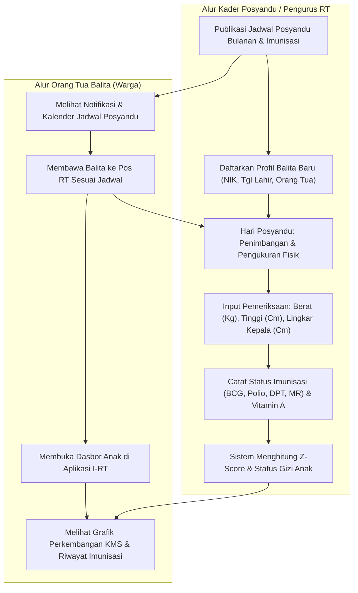
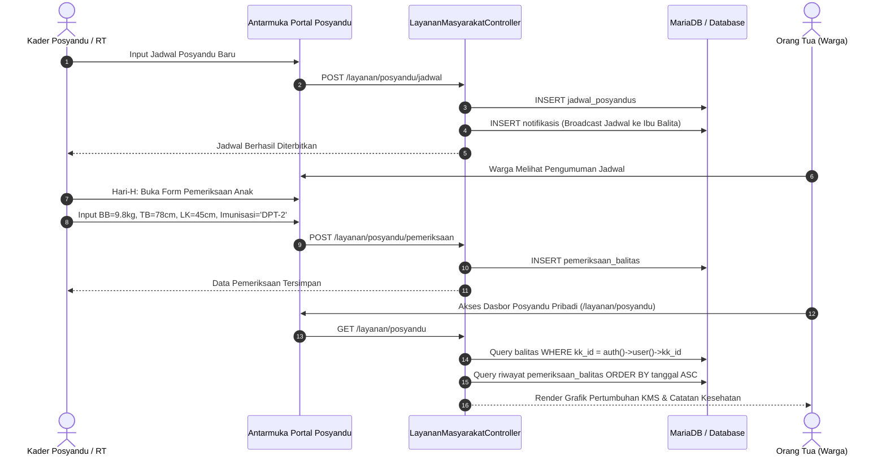
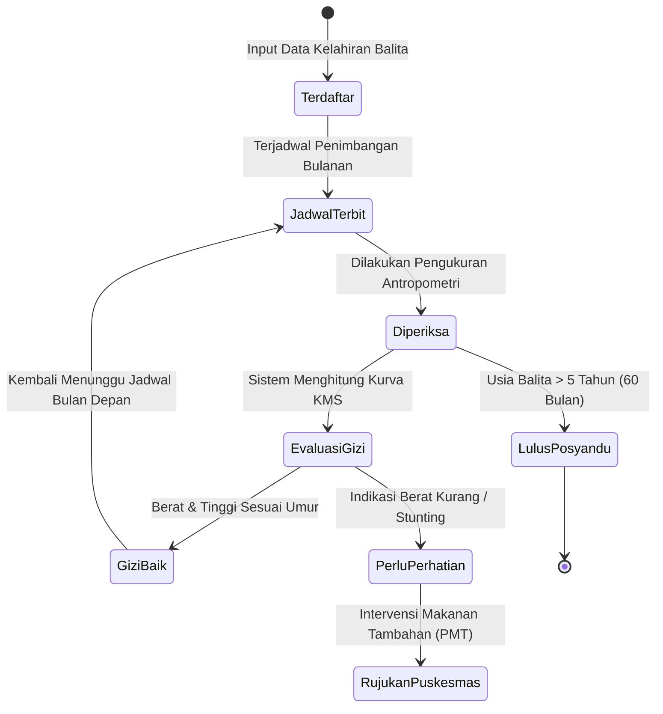

# FITUR: POSYANDU & KESEHATAN TUMBUH KEMBANG BALITA
**File Dokumentasi:** `docs/posyandu-balita.md`  
**Modul Sistem:** Layanan Kesehatan Lingkungan, Kartu Menuju Sehat (KMS) & Imunisasi Balita  
**Hak Akses:** Kader Posyandu / Pengurus RT, Warga (Orang Tua / Ibu Balita)  

---

## 1. Deskripsi & Nilai Bisnis Fitur

Fitur **Posyandu & Kesehatan Tumbuh Kembang Balita** mendigitalkan layanan pos pelayanan terpadu di tingkat rukun tetangga. Fitur ini memfasilitasi penjadwalan imunisasi berkala, pendataan identitas balita, pencatatan hasil penimbangan bulanan (Berat Badan, Tinggi Badan, Lingkar Kepala), serta pemantauan kurva pertumbuhan anak sesuai standar antropometri Kementerian Kesehatan Republik Indonesia (KMS Digital).

### Masalah yang Diselesaikan:
- Risiko hilangnya buku fisik KMS konvensional.
- Ketidaktahuan orang tua mengenai jadwal posyandu dan vitamin A berkala.
- Deteksi dini stunting atau malnutrisi pada balita di lingkungan RT melalui grafik analitik pertumbuhan otomatis.
- Rekapitulasi pelaporan data kesehatan balita ke tingkat Puskesmas/Kelurahan secara instan.

---

## 2. Alur Proses Bisnis (Business Flow)

---

## 3. Diagram UML

### A. Sequence Diagram: Pencatatan Hasil Pemeriksaan Posyandu

### B. State Diagram: Siklus Pemantauan Balita di Posyandu

---

## 4. Skema Database & Model Terkait

### Tabel Utama:
1. **`balitas`**: Identitas anak usia dini (`id`, `rt_id`, `kk_id`, `nama`, `nik`, `tanggal_lahir`, `jenis_kelamin`, `nama_ibu_user_id`, `nama_ayah`).
2. **`jadwal_posyandus`**: Kalender kegiatan posyandu (`id`, `rt_id`, `judul`, `tanggal`, `lokasi`, `keterangan`, `status`).
3. **`pemeriksaan_balitas`**: Rekam antropometri balita (`id`, `balita_id`, `jadwal_posyandu_id`, `berat_kg`, `tinggi_cm`, `lingkar_kepala_cm`, `imunisasi`, `catatan_kader`, `tanggal_periksa`).

### Relasi Model:
- `Balita belongsTo(KartuKeluarga::class)`
- `Balita hasMany(PemeriksaanBalita::class)`
- `PemeriksaanBalita belongsTo(JadwalPosyandu::class)`

---

## 5. Rute & Controller Endpoints

| Method | Endpoint URI | Controller & Action | Deskripsi Hak Akses |
|:---|:---|:---|:---|
| `GET` | `/layanan/posyandu` | `LayananMasyarakatController@posyandu` | Tampilan KMS Warga & Panel Entri Kader Posyandu |
| `POST` | `/layanan/posyandu/jadwal` | `LayananMasyarakatController@storeJadwalPosyandu`| Terbitkan agenda timbang bulanan pos RT |
| `PUT` | `/layanan/posyandu/jadwal/{id}`| `LayananMasyarakatController@updateJadwalPosyandu`| Edit waktu atau lokasi posyandu |
| `DELETE`| `/layanan/posyandu/jadwal/{id}`| `LayananMasyarakatController@destroyJadwalPosyandu`| Batalkan agenda posyandu |
| `POST` | `/layanan/posyandu/balita` | `LayananMasyarakatController@storeBalita` | Registrasi anak balita baru dalam KK |
| `POST` | `/layanan/posyandu/pemeriksaan`| `LayananMasyarakatController@storePemeriksaanBalita`| Simpan data BB, TB, LK, dan Imunisasi |

---

## 6. Pertimbangan DevOps, Grafik Visual & Kerahasiaan Data

1. **Rendering Grafik Client-Side Ringan (Chart.js)**:
   - Visualisasi kurva KMS memanfaatkan library JavaScript Chart.js yang dieksekusi di sisi peramban klien (*client-side rendering*), sehingga tidak membebani komputasi server.
2. **Isolasi Rekam Medis Anak**:
   - Data pemeriksaan antropometri anak hanya dapat diakses oleh kader wilayah RT balita tersebut dan akun orang tua yang nomor KK-nya cocok, memastikan privasi data tumbuh kembang anak terjaga.
