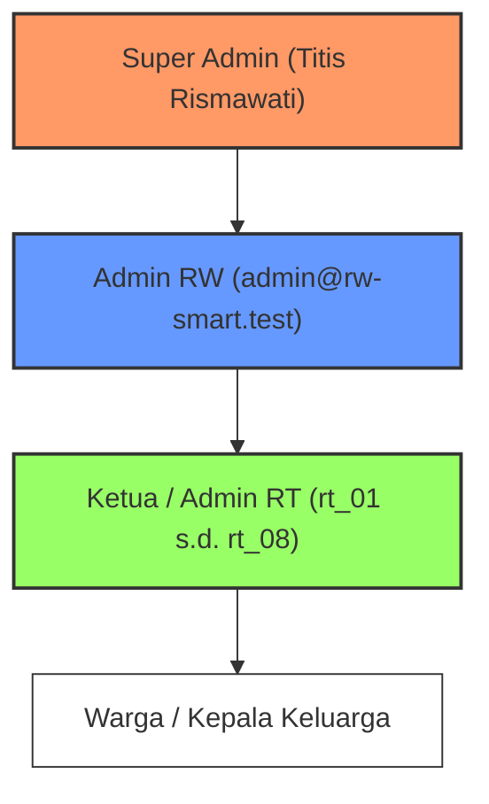

# PANDUAN PENGEMBANGAN SISTEM I-RT (RISMA-RT)
> **DOKUMEN WAJIB DIBACA OLEH SELURUH AI AGENT, SYSTEM DEVELOPER, DAN DEVOPS ENGINEER SEBELUM MEMODIFIKASI ATAU MEMPERLUAS SISTEM INI.**

---

## 1. Identitas & Filosofi Sistem

**I-RT (RISMA-RT / RW-SMART)** adalah platform *Civic-Tech & Digital Governance* tingkat rukun tetangga dan rukun warga (RT/RW) terpadu. Sistem ini dirancang untuk mendigitalkan administrasi kependudukan, transparansi tata kelola kas, pemberdayaan ekonomi lokal (UMKM & Bank Sampah), pelayanan surat-menyurat instan, pemantauan kesehatan balita (Posyandu), ketertiban lingkungan (Ronda & Smart CCTV), serta kanal aspirasi masyarakat yang akuntabel.

### Prinsip Inti Rekayasa Perangkat Lunak (Engineering Principles)
1. **Privacy & Data Isolation First**: Data kependudukan (NIK, KK, kontak pribadi) adalah data sensitif. Penegakan multi-tenancy wilayah (RT/RW) wajib diterapkan di level query/model scoping, bukan hanya di level UI.
2. **Transaction Integrity**: Semua operasi multi-tabel (seperti verifikasi pembayaran kas, penarikan saldo bank sampah, dan mutasi warga) **wajib** dibungkus dalam `DB::transaction()` dengan locking yang tepat.
3. **Auditability**: Setiap aksi administratif krusial (perubahan status pembayaran, persetujuan surat, mutasi warga, eskalasi aspirasi, penyesuaian saldo) **harus tercatat** dalam log audit (`audit_logs` / `rt_audits`).
4. **Resilient & Low-Overhead**: Sistem harus dapat berjalan mulus pada resource VPS minimal (1 vCPU, 1–2 GB RAM) berbasis LAMP/LEMP stack modern.

---

## 2. Hirarki Peran (Role & Access Control Matrix)

Sistem menggunakan kontrol akses berbasis peran (RBAC) dengan 4 pilar utama:



### 1. Super Admin (`is_super_admin = true`, role `super_admin`)
- **Fungsi**: Pemilik platform & master administrator.
- **Kewenangan**: Memiliki bypass penuh ke seluruh modul, dashboard audit global, konfigurasi sistem, dan fitur **Multi-Role Switching** (dapat beralih konteks sementara menjadi Ketua RW, Ketua RT, maupun Warga tanpa logout untuk keperluan supervisi dan debugging).

### 2. Administrator RW (`role_id` = `rw` / `admin`)
- **Fungsi**: Pengawas dan pemegang kebijakan tata kelola agregat tingkat Rukun Warga.
- **Kewenangan**:
  - Monitoring wilayah komprehensif lintas RT (RT 01 s.d. RT 08).
  - Validasi dan pengesahan surat tingkat RW (Surat Pengantar RW).
  - Manajemen metode pembayaran kas digital (QRIS, VA Bank, Rekening Kas RW).
  - Audit keuangan kas dan iuran seluruh RT.
  - Pengumuman resmi RW dan koordinasi kegiatan bersama lintas RT.

### 3. Pengurus / Ketua RT (`role_id` = `rt` atau `rt_01` .. `rt_08`)
- **Fungsi**: Pelaksana teknis operasional harian di wilayah RT masing-masing.
- **Kewenangan Terisolasi (Scoped)**:
  - Validasi data warga, verifikasi akun baru, dan mutasi kependudukan di RT-nya.
  - Verifikasi pembayaran iuran & pembukuan kas RT.
  - Input & validasi setoran bank sampah serta persetujuan penarikan saldo.
  - Pembuatan & otomasi jadwal ronda malam, validasi presensi ronda, dan tanggap darurat (Panic Report).
  - Pencatatan kegiatan posyandu dan tumbuh kembang balita (KMS).
  - Moderasi UMKM warga lokal RT.
  - Tindak lanjut aspirasi & pengaduan tingkat RT sebelum dieskalasi ke RW.
- **Batasan**: **Tidak boleh** melihat atau memodifikasi kas, data warga, dan permohonan surat dari RT lain (`RtWargaScope` & `RtCctvScope`).

### 4. Warga (`role_id` = `warga`)
- **Fungsi**: Pengguna akhir layanan publik (End User / Resident).
- **Kewenangan Mandiri**:
  - Akses dashboard personal (ringkasan iuran, saldo bank sampah, jadwal ronda, status surat).
  - Pengajuan surat administrasi mandiri beserta unggah berkas persyaratan.
  - Pembayaran iuran digital & unggah bukti transfer.
  - Pembukaan toko UMKM & katalog produk lokal.
  - Konfirmasi kehadiran kegiatan (RSVP).
  - Pelaporan aspirasi/pengaduan (dengan opsi anonim).
  - Tombol darurat (*Panic Button SOS*) dengan transmisi geolokasi GPS ke pengurus ronda.

---

## 3. Standar & Konvensi Kode (Coding Guidelines)

### Stack Teknologi Baku
- **Language**: PHP 8.3+ (Gunakan strict types, constructor property promotion, match expressions).
- **Framework**: Laravel 11 / Laravel 13.
- **Database**: MySQL 8.0+ / MariaDB 10.11+.
- **Frontend Web**: Laravel Blade + Bootstrap 5 + FontAwesome 6 + Vite.
- **Libraries Inti**: `barryvdh/laravel-dompdf` (PDF Generation), `maatwebsite/excel` (Excel Export/Import).

### Aturan Arsitektur & Controller
1. **Thin Controller, Fat Service/Model**: Hindari logika bisnis kompleks di Controller. Gunakan Model Query Scopes, Eloquent Accessors/Mutators, atau Service/Action Classes.
2. **Defensive Database Queries**:
   - Selalu batasi query dengan scope RT untuk pengurus:
     ```php
     $rtId = auth()->user()->rt_id;
     $warga = Warga::where('rt_id', $rtId)->get();
     ```
   - Manfaatkan Global/Local Scope yang sudah disediakan (`App\Models\Scopes\RtWargaScope`, `RtCctvScope`).
3. **Form Request & Sanitasi**:
   - Validasi data input secara ketat. Sanitasi string yang akan dirender langsung di HTML untuk mencegah XSS.
   - Gunakan hashing kuat (`Hash::make()`) untuk seluruh kredensial sandi.
4. **File Handling**:
   - Simpan berkas bukti transfer, dokumen identitas, dan foto produk ke dalam disk `public` via Laravel Storage (`Storage::disk('public')->putFile(...)`).
   - Jangan pernah menyimpan path absolut file di database; simpan hanya relative path (`uploads/bukti/...`).
5. **Database Transaction Pattern**:
   ```php
   use Illuminate\Support\Facades\DB;

   DB::beginTransaction();
   try {
       // Operasi 1: Update status pembayaran
       // Operasi 2: Buat entri kas masuk
       // Operasi 3: Rekam audit log
       DB::commit();
   } catch (\Throwable $e) {
       DB::rollBack();
       report($e);
       return back()->with('error', 'Gagal memproses transaksi: ' . $e->getMessage());
   }
   ```

---

## 4. Protokol Migrasi & Skema Database

1. **Anti-Destructive Migrations**:
   - Dilarang membuat migrasi yang melakukan `dropTable` atau menghapus kolom tanpa mekanisme backup data pada lingkungan production.
   - Selalu gunakan `if (!Schema::hasColumn('tabel', 'kolom'))` dan `if (Schema::hasTable('tabel'))` agar migrasi dapat diulang (*idempotent*) tanpa kegagalan sintaks.
2. **Indexing Standard**:
   - Setiap kolom relasi *foreign key* wajib memiliki index (`$table->foreignId('rt_id')->constrained()->cascadeOnDelete();` atau `$table->index('rt_id');`).
   - Index wajib ditambahkan pada kolom pencarian frekuensi tinggi (`status`, `tanggal`, `kode_transaksi`, `nik`).
3. **Data Seeding**:
   - Seeder harus menggunakan `firstOrCreate()` atau `updateOrCreate()` agar aman dieksekusi berulang kali (`php artisan db:seed`) tanpa menimbulkan duplikasi baris data.

---

## 5. Standar DevOps, Deployment & Keamanan

### Pipeline & Konfigurasi Lingkungan (.env)
- `APP_ENV`: Wajib bernilai `production` saat rilis; matikan `APP_DEBUG=false`.
- `SESSION_SECURE_COOKIE`: Aktifkan jika menggunakan protokol HTTPS.
- File izin: Pastikan folder `storage/` dan `bootstrap/cache/` memiliki izin tulis oleh web server (`chmod -R 775 storage bootstrap/cache`).

### Prosedur Rilis Pembaruan (Deployment Checklist)
Setiap pembaruan yang didorong oleh Developer atau Agent wajib menjalankan urutan perintah berikut:
```bash
# 1. Update dependency jika ada perubahan composer.json
composer install --no-dev --optimize-autoloader

# 2. Eksekusi migrasi database
php artisan migrate --force

# 3. Buat symlink storage publik jika belum tersedia
php artisan storage:link

# 4. Refresh & optimasi cache sistem
php artisan optimize:clear
php artisan config:cache
php artisan route:cache
php artisan view:cache

# 5. Build asset frontend
npm install && npm run build
```

---

## 6. Instruksi Operasional Khusus bagi AI Agent

Ketika AI Agent diminta untuk membuat, memperbaiki, atau merefaktor modul:
1. **Baca Blueprint & Fitur Terkait Terlebih Dahulu**: Jangan berasumsi tentang arsitektur. Buka `docs/blueprint.md` dan file fitur spesifik `docs/[NAMA_FITUR].md` untuk memahami alur bisnis, relasi tabel, dan role yang terlibat.
2. **Patuhi Hak Akses Wilayah**: Jangan pernah memberikan akses data warga lintas RT kepada pengguna dengan role RT tanpa otorisasi Super Admin atau RW.
3. **Pertahankan Integritas Dokumentasi**: Seluruh diagram Mermaid dan dokumen teknis yang diperbarui harus mematuhi standar notasi UML yang valid.
4. **Verifikasi Jalur Route**: Jangan menduplikasi nama rute (*route name collision*). Gunakan namespace dan prefix yang telah dipetakan di `routes/web.php`.
5. **Gaya Komunikasi**: Berikan penjelasan teknis yang lugas, presisi, berorientasi arsitektur DevOps senior, dan sertakan instruksi reproduksi/pengujian.
