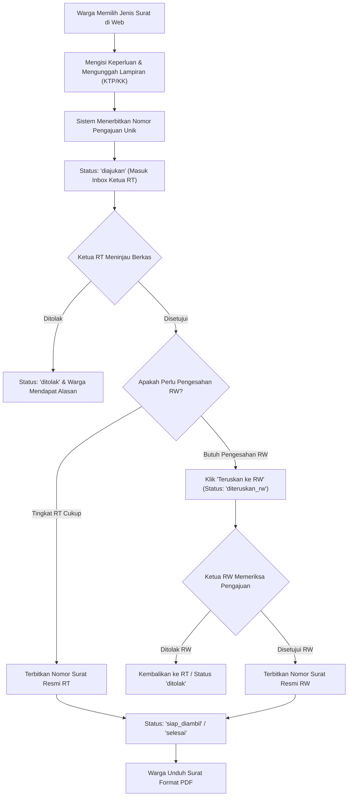
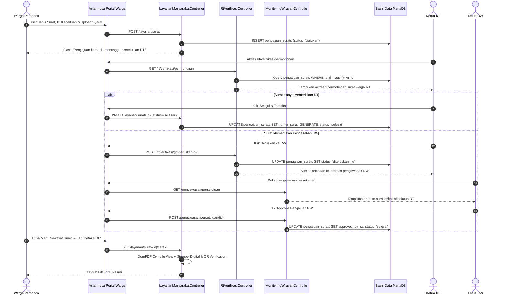
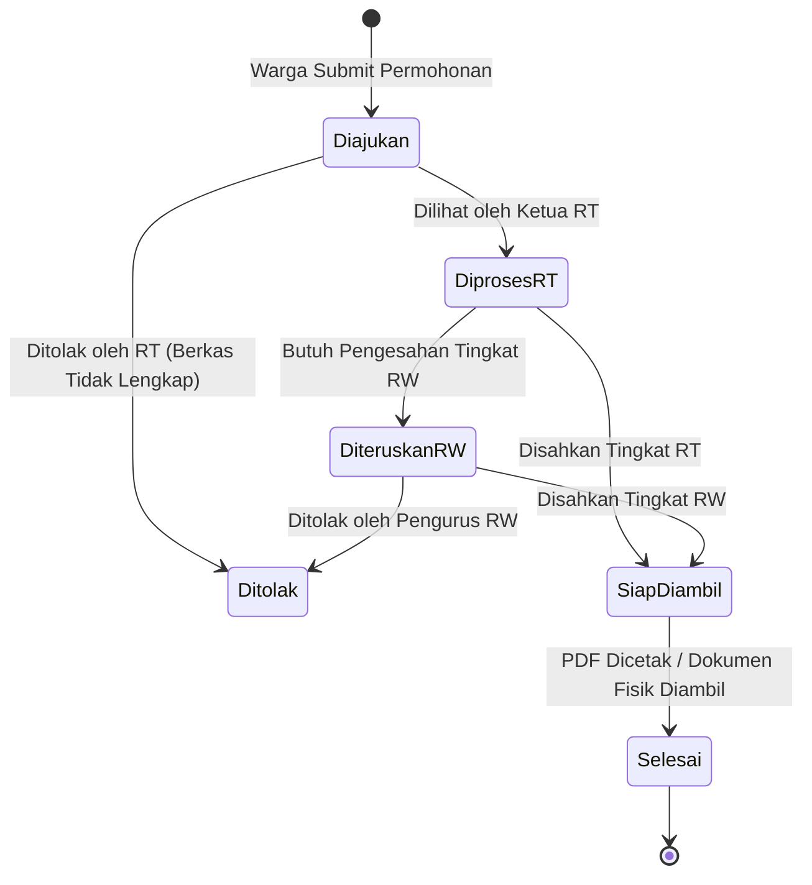

# FITUR: PELAYANAN SURAT-MENYURAT DIGITAL
**File Dokumentasi:** `docs/surat-menyurat.md`  
**Modul Sistem:** E-Government Lingkungan, Administrasi Persuratan & Pengantar Berjenjang  
**Hak Akses:** Warga (Pemohon), Ketua RT (Verifikator Tingkat 1), Ketua RW (Verifikator Tingkat 2)  

---

## 1. Deskripsi & Nilai Bisnis Fitur

Fitur **Pelayanan Surat-Menyurat Digital** mendigitalkan birokrasi permohonan surat pengantar lingkungan yang selama ini memakan waktu dan mengharuskan warga mendatangi kediaman pengurus secara tatap muka. Warga dapat mengajukan berbagai jenis surat pengantar dari ponsel secara 24/7, mengunggah dokumen persyaratan, dan memantau progres persetujuan berjenjang dari Ketua RT hingga Ketua RW secara *real-time*.

### Jenis Surat yang Dilayani:
1. **Surat Pengantar Domisili** (Kependudukan / Kantor Kelurahan).
2. **Surat Pengantar SKCK** (Surat Keterangan Catatan Kepolisian).
3. **Surat Keterangan Tidak Mampu (SKTM)** (Bantuan Pendidikan & Kesehatan).
4. **Surat Pengantar Pembuatan KK / KTP Baru**.
5. **Surat Keterangan Usaha (SKU)** (Persyaratan Modal Bank / Izin Usaha).
6. **Surat Keterangan Kematian / Kelahiran Lingkungan**.

---

## 2. Alur Proses Bisnis Berjenjang (Multi-Tier Workflow)

---

## 3. Diagram UML

### A. Sequence Diagram: Alur Pengajuan Surat Berjenjang RT ke RW

### B. State Diagram: Siklus Status Pengajuan Surat

---

## 4. Skema Database & Model Terkait

### Tabel Utama:
1. **`jenis_surats`**: Master jenis dokumen dan template persuratan (`id`, `kode`, `nama`, `template`, `persyaratan_json`, `status`).
2. **`pengajuan_surats`**: Log dan berkas permohonan surat (`id`, `user_id`, `rt_id`, `jenis_surat_id`, `nomor_pengajuan`, `nomor_surat`, `keperluan`, `data_form_json`, `lampiran`, `status`, `catatan_rt`, `catatan_rw`, `approved_by_rt`, `approved_by_rw`, `approved_at_rt`, `approved_at_rw`, `file_pdf`).

### Relasi Model:
- `PengajuanSurat belongsTo(User::class)`
- `PengajuanSurat belongsTo(JenisSurat::class)`
- `PengajuanSurat belongsTo(Rt::class)`

---

## 5. Rute & Controller Endpoints

| Method | Endpoint URI | Controller & Action | Deskripsi Hak Akses |
|:---|:---|:---|:---|
| `GET` | `/layanan/surat` | `LayananMasyarakatController@surat` | Antarmuka riwayat & formulir pengajuan warga |
| `POST` | `/layanan/surat` | `LayananMasyarakatController@storeSurat` | Penyimpanan draf pengajuan baru oleh warga |
| `PATCH` | `/layanan/surat/{id}` | `LayananMasyarakatController@updateSurat` | Approval/reject langsung oleh RT |
| `GET` | `/layanan/surat/{id}/cetak`| `LayananMasyarakatController@cetakSurat` | Kompilasi PDF resmi melalui DomPDF |
| `GET` | `/rt/verifikasi/permohonan`| `RtVerifikasiController@permohonan` | Meja kerja verifikasi surat Ketua RT |
| `POST` | `/rt/verifikasi/{id}/teruskan-rw`| `RtVerifikasiController@teruskanKeRw` | Eskalasi persetujuan surat ke tingkat RW |
| `GET` | `/pengawasan/persetujuan` | `MonitoringWilayahController@pengajuanRw` | Antrean surat lintas RT di meja Ketua RW |
| `POST` | `/pengawasan/persetujuan/{id}` | `MonitoringWilayahController@approvePengajuanRw` | Pengesahan akhir surat oleh Ketua RW |

---

## 6. Pertimbangan DevOps, Cetak PDF & Keabsahan Digital

1. **Otomasi Pembuatan Nomor Surat (Automatic Running Number)**:
   - Nomor surat disusun dengan format standar kearsipan pemerintah lingkungan:
     `{NOMOR_URUT}/RT{KODE_RT}/RW{KODE_RW}/{BULAN_ROMAWI}/{TAHUN}` (contoh: `042/RT03/RW05/XI/2026`).
2. **Kompilasi PDF Andal (Headless DomPDF)**:
   - Template surat menggunakan font standar Helvetica/Times untuk meminimalkan beban rendering memori server (`memory_limit = 256M`).
   - Dokumen PDF disisipkan kode QR verifikasi yang mengarah ke URL publik untuk membuktikan keaslian dokumen tanpa risiko pemalsuan fisik stempel.
