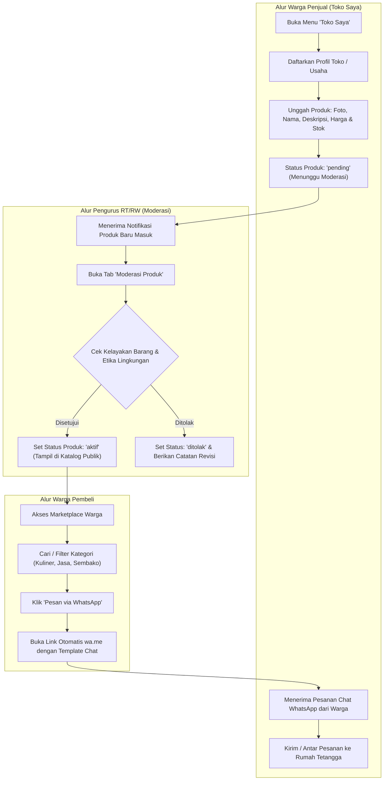
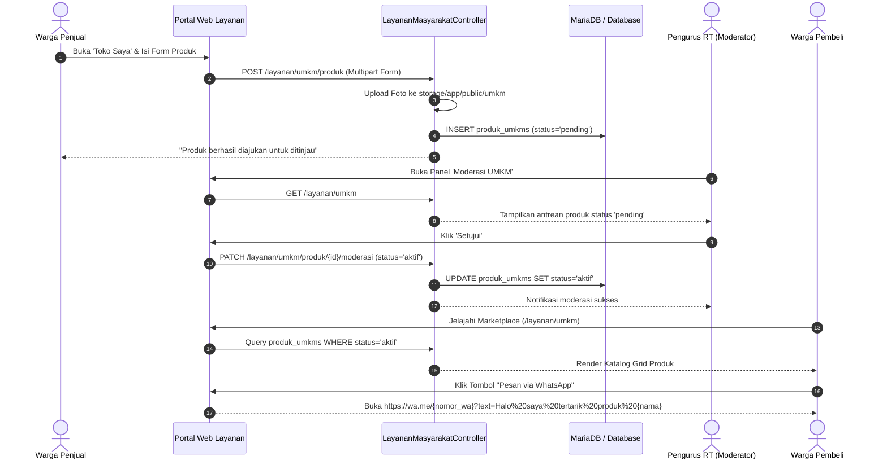
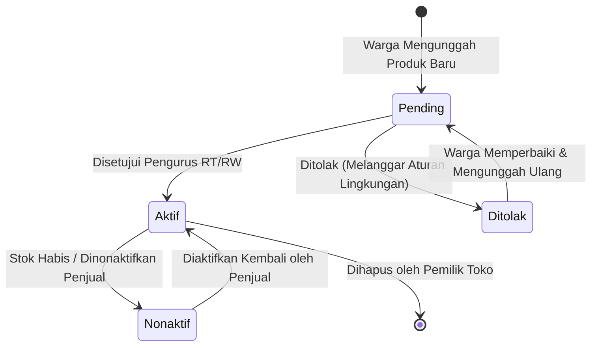

# FITUR: UMKM WARGA & MARKETPLACE LOKAL
**File Dokumentasi:** `docs/umkm-warga.md`  
**Modul Sistem:** Pemberdayaan Ekonomi Warga, Toko Lokal & Marketplace Lingkungan  
**Hak Akses:** Warga (Penjual & Pembeli), Pengurus RT/RW (Moderator)  

---

## 1. Deskripsi & Nilai Bisnis Fitur

Fitur **UMKM Warga & Marketplace Lokal** adalah wadah promosi dan transaksi ekonomi sirkular antar-warga dalam satu lingkungan rukun tetangga dan rukun warga. Warga yang memiliki usaha rumahan (kuliner, sembako, jasa jahit, servis elektronik, kerajinan, dsb.) dapat mendaftarkan toko dan memamerkan produk dagangannya. Pembeli (tetangga) dapat langsung terhubung dengan penjual melalui tombol pemesanan cepat WhatsApp.

### Masalah yang Diselesaikan:
- Rendahnya keterpaparan produk dagangan warga kepada tetangga terdekat.
- Menghindari potongan komisi aplikasi ojek online komersial yang tinggi untuk transaksi antar-tetangga.
- Menjamin keamanan dan kenyamanan transaksi lokal dengan penjual yang sudah terverifikasi sebagai warga sah lingkungan tersebut.
- Moderasi produk oleh pengurus lingkungan guna mencegah penjualan barang terlarang atau konten tidak pantas.

---

## 2. Alur Proses Bisnis (Business Flow)

---

## 3. Diagram UML

### A. Sequence Diagram: Pendaftaran Produk & Direct WhatsApp Order

### B. State Diagram: Siklus Hidup Produk UMKM

---

## 4. Skema Database & Model Terkait

### Tabel Utama:
1. **`umkms`**: Profil entitas usaha warga (`id`, `user_id`, `nama_usaha`, `kategori`, `deskripsi`, `alamat`, `kontak`, `status`).
2. **`produk_umkms`**: Daftar item barang/jasa yang dijual (`id`, `umkm_id`, `nama_produk`, `deskripsi`, `harga`, `stok`, `foto`, `status`, `catatan_moderasi`).

### Model Terkait:
- `App\Models\Umkm`: Memiliki relasi `belongsTo(User::class)` dan `hasMany(ProdukUmkm::class)`.
- `App\Models\ProdukUmkm`: Memiliki relasi `belongsTo(Umkm::class)` dengan scope query `scopeAktif($query)`.

---

## 5. Rute & Controller Endpoints

| Method | Endpoint URI | Controller & Action | Deskripsi Hak Akses |
|:---|:---|:---|:---|
| `GET` | `/layanan/umkm` | `LayananMasyarakatController@umkm` | Katalog publik marketplace & dasbor penjual |
| `POST` | `/layanan/umkm/toko-saya` | `LayananMasyarakatController@storeUmkm` | Registrasi profil toko warga mandiri |
| `PATCH` | `/layanan/umkm/{umkm}/toggle` | `LayananMasyarakatController@toggleUmkmStatus` | Buka/tutup operasional toko |
| `POST` | `/layanan/umkm/produk` | `LayananMasyarakatController@storeProdukUmkm` | Unggah produk baru beserta foto |
| `PUT` | `/layanan/umkm/produk/{id}` | `LayananMasyarakatController@updateProdukUmkm` | Pembaruan data, harga, atau stok produk |
| `DELETE`| `/layanan/umkm/produk/{id}` | `LayananMasyarakatController@destroyProdukUmkm`| Hapus produk dari etalase |
| `PATCH` | `/layanan/umkm/produk/{id}/moderasi`| `LayananMasyarakatController@moderateProdukUmkm`| Kurasi produk (Approve/Reject) oleh RT |

---

## 6. Pertimbangan DevOps, Media & Skalabilitas

1. **Optimasi Berkas Gambar (Image Resizing & Compression)**:
   - Gambar produk diunggah dengan format WebP atau JPEG terkompresi guna menghemat bandwidth mobile user dan kapasitas disk server.
2. **Pembersihan Berkas Orphan (Storage Cleanup)**:
   - Ketika model `ProdukUmkm` dihapus (`destroyProdukUmkm`), sistem secara otomatis menghapus berkas fisik foto terkait dari `storage/app/public/umkm` untuk mencegah pemborosan storage (*orphaned file leak*).
3. **Format Kontak WhatsApp Terstandarisasi**:
   - Nomor telepon dinormalisasi ke format internasional (misal mengubah `0812xxxx` menjadi `62812xxxx`) agar tautan URL `wa.me` berfungsi sempurna pada perangkat desktop maupun smartphone.
