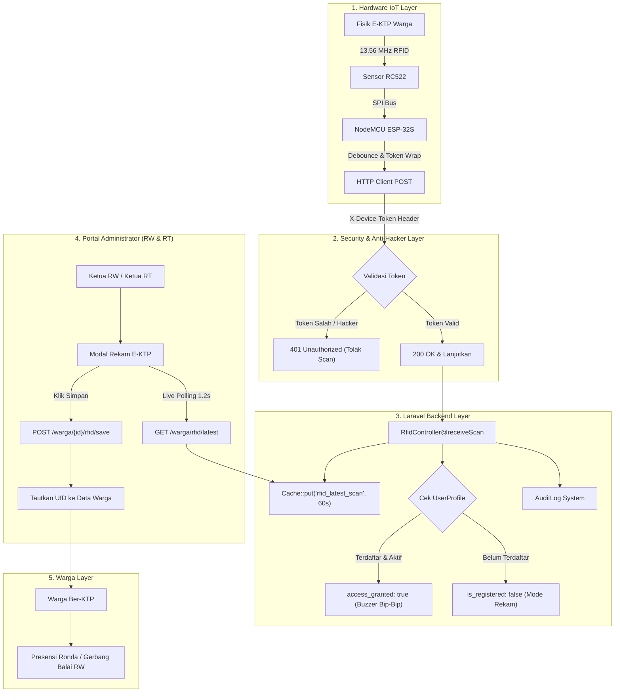

# PANDUAN INTEGRASI IOT: NODEMCU ESP-32S + RFID-RC522 KE LARAVEL SMART RW

Dokumentasi ini menjelaskan konfigurasi rangkaian perangkat keras, arsitektur keamanan anti-hacker (token autentikasi), kode program Arduino IDE, serta **Role Breakdown** pembagian peran dalam ekosistem SMART RW.

---

## 1. Skema Rangkaian Hardware (Wiring Diagram)

### Komponen yang Dibutuhkan:
1. **1x Board NodeMCU ESP-32S** (ESP32 Dev Module, 30 Pin atau 38 Pin).
2. **1x Modul Sensor RFID-RC522** (Frekuensi 13.56 MHz, kompatibel E-KTP RI / ISO14443A) dengan pin header tersolder.
3. **7x Kabel Jumper Female-to-Female** (panjang 15–20 cm).
4. **1x Buzzer Aktif/Pasif** (Opsional untuk nada feedback sukses/gagal).
5. **2x LED Indikator (Hijau & Merah) + Resistor 220Ω** (Opsional untuk status visual).
6. **Kabel Micro-USB** untuk transfer program dan catu daya ke Laptop/Charger 5V.

---

### Tabel Sambungan Pin (Jumper Female-to-Female):

| Pin RFID-RC522 | Warna Kabel Disarankan | Pin NodeMCU ESP-32S | Fungsi Sinyal / Keterangan |
| :--- | :--- | :--- | :--- |
| **3.3V (VCC)** | **Merah** | **3V3** | **Catu Daya 3.3V (JANGAN KE 5V/VIN! RC522 AKAN RUSAK)** |
| **RST (Reset)** | Oranye | **GPIO 22** | Pin Reset Kontrol Hardware Sensor |
| **GND (Ground)** | **Hitam** | **GND** | Ground Bersama (Common Ground) |
| **IRQ** | *(Tidak Dipakai)* | *(KOSONG / NC)* | Tidak dihubungkan (Not Connected) |
| **MISO** | Kuning | **GPIO 19** | SPI Master In Slave Out (Data Sensor ke ESP32) |
| **MOSI** | Hijau | **GPIO 23** | SPI Master Out Slave In (Data ESP32 ke Sensor) |
| **SCK** | Biru | **GPIO 18** | SPI Serial Clock |
| **SDA (SS / CS)** | Putih | **GPIO 5** | SPI Slave Select / Chip Enable |

#### Pin Tambahan Indikator (Buzzer & LED):
- **Buzzer (+)** $\rightarrow$ **GPIO 13** | **Buzzer (-)** $\rightarrow$ **GND**
- **LED Hijau (+)** $\rightarrow$ **GPIO 12** *(lewat resistor 220Ω)* | **LED Hijau (-)** $\rightarrow$ **GND**
- **LED Merah (+)** $\rightarrow$ **GPIO 14** *(lewat resistor 220Ω)* | **LED Merah (-)** $\rightarrow$ **GND**

---

### Diagram Visual Koneksi Pin:

```text
       +---------------------------------------+
       |           NODEMCU ESP-32S             |
       |                                       |
       |  [ 3V3 ] ------------------------+    |
       |  [ GND ] ---------------------+  |    |
       |  [ D22 ] -------------+       |  |    |
       |  [ D19 ] ---------+   |       |  |    |
       |  [ D23 ] -----+   |   |       |  |    |
       |  [ D18 ] -+   |   |   |       |  |    |
       |  [  D5 ] -|-+-|-+-|-+-|---+   |  |    |
       |           | | | | | | |   |   |  |    |
       +-----------|-|-|-|-|-|-|---|---|--|----+
                   | | | | | | |   |   |  |
                   | | | | | | |   |   |  +---> [ 3.3V ]
                   | | | | | | |   |   +------> [ GND  ]
                   | | | | | | |   +----------> [ RST  ]
                   | | | | | | +--------------> (IRQ Kosong)
                   | | | | | +----------------> [ MISO ]
                   | | | | +------------------> [ MOSI ]
                   | | | +--------------------> [ SCK  ]
                   | | +----------------------> [ SDA  ]
                   |
                   v
       +-----------------------+
       |      RFID-RC522       |
       |     (13.56 MHz)       |
       +-----------------------+
```

> [!CAUTION]
> **PENTING: TEGANGAN RC522 HARUS 3.3V (3V3)**  
> Modul RFID-RC522 hanya toleran terhadap tegangan **3.3 Volt**. Jangan pernah menyambungkannya ke pin **VIN** atau **5V** karena dapat membakar IC MFRC522.

---

## 2. Arsitektur Keamanan Anti-Hacker (Device Security Token)

### Mengapa Dibutuhkan Token Keamanan?
Tanpa token keamanan, endpoint penerima data scan (`POST /api/rfid/scan`) dapat diserang oleh siapa pun di jaringan WiFi lokal (misalnya menggunakan Postman, curl, atau skrip hacker) untuk mengirim UID palsu atau melakukan spamming database.

### Mekanisme Proteksi SMART RW:
1. **Device Security Token (`X-Device-Token`)**:
   - Diatur di file `.env` Laravel:
     ```env
     RFID_DEVICE_TOKEN=smart-rw-iot-secret-key-2026
     ```
   - Diatur sama persis pada kode Arduino ESP32:
     ```cpp
     const char* DEVICE_SECURITY_TOKEN = "smart-rw-iot-secret-key-2026";
     ```
   - Setiap request scan dari ESP32 menyertakan token ini di **HTTP Header (`X-Device-Token`)** dan **JSON Payload**.
   - Server Laravel menolak (HTTP 401 Unauthorized) jika token tidak cocok atau tidak dikirim.
2. **Tanda Tangan Integritas HMAC-SHA256**:
   - Server Laravel membuat `verification_token` berbasis hash HMAC dengan rumus:  
     $$\text{hash\_hmac}('sha256', \text{UID} \parallel \text{Timestamp} \parallel \text{StatusAkses}, \text{SecretToken})$$
   - Mencegah serangan *man-in-the-middle* (MITM) dan pemalsuan status izin masuk.
3. **Filter Anti-Spam (Cooldown Debounce)**:
   - ESP32 menerapkan jeda 2.5 detik untuk kartu yang sama agar tidak membanjiri server (*request flooding*).
4. **Isolasi Wilayah RT**:
   - Meskipun UID kartu berhasil dipindai perangkat, Ketua RT hanya diizinkan menautkan kartu ke warga di wilayah RT-nya sendiri.

---

## 3. Langkah Pengaturan di Arduino IDE

1. **Buka Arduino IDE** (versi 1.8.x atau versi 2.x).
2. **Pasang Board ESP32**:
   - Buka menu **File** $\rightarrow$ **Preferences**.
   - Pada kolom *Additional Boards Manager URLs*, tambahkan:  
     `https://raw.githubusercontent.com/espressif/arduino-esp32/gh-pages/package_esp32_index.json`
   - Buka **Tools** $\rightarrow$ **Board** $\rightarrow$ **Boards Manager**, cari `esp32` by **Espressif Systems**, lalu klik **Install**.
3. **Pasang Library yang Dibutuhkan**:
   - Buka **Tools** $\rightarrow$ **Manage Libraries...**
   - Cari dan install:
     1. **MFRC522** by *GithubCommunity* (versi terbaru).
     2. **ArduinoJson** by *Benoit Blanchon* (versi 6.x atau 7.x).
4. **Pilih Board & Port**:
   - **Tools** $\rightarrow$ **Board** $\rightarrow$ **ESP32 Arduino** $\rightarrow$ **NodeMCU-32S** (atau *ESP32 Dev Module*).
   - **Tools** $\rightarrow$ **Port** $\rightarrow$ Pilih port COM tempat kabel USB ESP32 terhubung (contoh: `COM3`, `COM5`).
5. **Buka File Sketch**:
   - Buka file [esp32/smart_rw_rfid/smart_rw_rfid.ino](file:///c:/laragon/www/risma-rt/esp32/smart_rw_rfid/smart_rw_rfid.ino).
6. **Sesuaikan Konfigurasi Jaringan**:
   ```cpp
   const char* WIFI_SSID       = "NAMA_WIFI_ANDA";
   const char* WIFI_PASSWORD   = "PASSWORD_WIFI_ANDA";

   // Ganti dengan IP Laptop/Komputer yang menjalankan Laragon
   const char* SERVER_SCAN_URL = "http://192.168.1.100/api/rfid/scan";
   const char* DEVICE_SECURITY_TOKEN = "smart-rw-iot-secret-key-2026";
   ```
   > **Tips Cara Mengetahui IP Laptop:**  
   > Buka PowerShell atau CMD di Windows, ketik `ipconfig`, lalu lihat bagian **IPv4 Address** (contoh: `192.168.1.15`). Pastikan ESP32 dan Laptop terhubung ke WiFi/hotspot yang sama.
7. **Upload Kode**:
   - Klik tombol **Upload** (tanda panah ke kanan $\rightarrow$).
   - Buka **Tools** $\rightarrow$ **Serial Monitor**, atur baud rate ke **115200**.
   - Tempelkan kartu fisik E-KTP ke sensor RC522. Serial Monitor akan menampilkan UID dan respon dari server!

---

## 4. Role Breakdown (Pembagian Peran Sistem)



### Penjelasan Detail Tiap Role:

### 1. Peran Hardware IoT (NodeMCU ESP-32S & RFID RC522)
- **Deteksi Frekuensi**: Mendeteksi sinyal radio 13.56 MHz dari chip E-KTP warga tanpa sentuhan mekanik.
- **Ekstraksi UID**: Membaca serial number unik 4 hingga 7 byte dari kartu dan mengubahnya menjadi format hexadecimal bersih (`04A1B2C3`).
- **Debounce Filter**: Memblokir pembacaan berulang dari kartu yang sama selama 2.5 detik.
- **Audio-Visual Feedback**: Mengendalikan buzzer dan lampu LED sesuai respon dari server:
  - *Bip ganda ceria + LED Hijau*: Akses diterima / E-KTP terverifikasi.
  - *Satu buzz panjang + LED Merah*: Akses ditolak / kartu tidak dikenal / serangan token salah.
  - *Tiga bip cepat*: Akun warga berstatus pending (menunggu verifikasi RT).

### 2. Peran Security Gateway & Device Token (Anti-Hacker)
- **Otentikasi Kunci Rahasia**: Memverifikasi bahwa request hanya berasal dari perangkat keras resmi SMART RW yang memiliki token rahasia (`RFID_DEVICE_TOKEN`).
- **Integritas Data**: Menghasilkan tanda tangan digital HMAC-SHA256 untuk memverifikasi keabsahan data tanpa bisa dipalsukan.
- **Proteksi CSRF & Rate Limiting**: Membatasi akses request liar dari pihak luar.

### 3. Peran Backend Laravel (RfidController & Database)
- **Endpoint `POST /api/rfid/scan`**: Menerima data scan dari ESP32, memverifikasi token, dan mencocokkan UID dengan database `user_profiles`.
- **Buffer Cache 60 Detik (`rfid_latest_scan`)**: Menyimpan scan terbaru dalam memori sementara agar bisa langsung ditangkap oleh antarmuka web pengurus.
- **Audit Logging**: Mencatat setiap aktivitas scan dan perekaman kartu ke tabel `audit_logs` untuk rekam jejak digital.

### 4. Peran Administrator & Pengurus (Super Admin, Ketua RW, dan Ketua RT)
- **Portal Data Warga**: Melihat status kepemilikan E-KTP tiap warga (badge hijau `E-KTP: [UID]` atau abu-abu `Belum Ada`).
- **Modal Rekam E-KTP Interaktif**:
  - Pengurus mengklik tombol **"Rekam KTP"** di baris warga yang bersangkutan.
  - Modal terbuka dan melakukan *live polling* ke `/warga/rfid/latest` setiap 1.2 detik.
  - Saat warga menempelkan fisik E-KTP pada scanner ESP32, nomor UID otomatis muncul di layar modal.
  - Deteksi duplikasi otomatis: sistem mencegah satu kartu E-KTP digunakan oleh dua warga berbeda.
  - Pengurus mengklik **"Simpan & Tautkan E-KTP"**, UID tersimpan permanen di profil warga.
- **Isolasi Wilayah**: Ketua RT 01 hanya dapat merekam dan mengelola data warga di wilayah RT 01.

### 5. Peran Warga (E-KTP Sebagai Kunci Akses Layanan)
- **Satu Kartu Multifungsi**: Fisik E-KTP yang sudah dimiliki warga menjadi alat identitas dan akses digital tanpa perlu kartu tambahan.
- **Akses Layanan Nyata**:
  - Presensi kehadiran pos ronda malam.
  - Akses buka gerbang balai RW / portal lingkungan.
  - Verifikasi penerimaan bantuan sosial atau layanan administrasi surat menyurat di kantor sekretariat RW.
